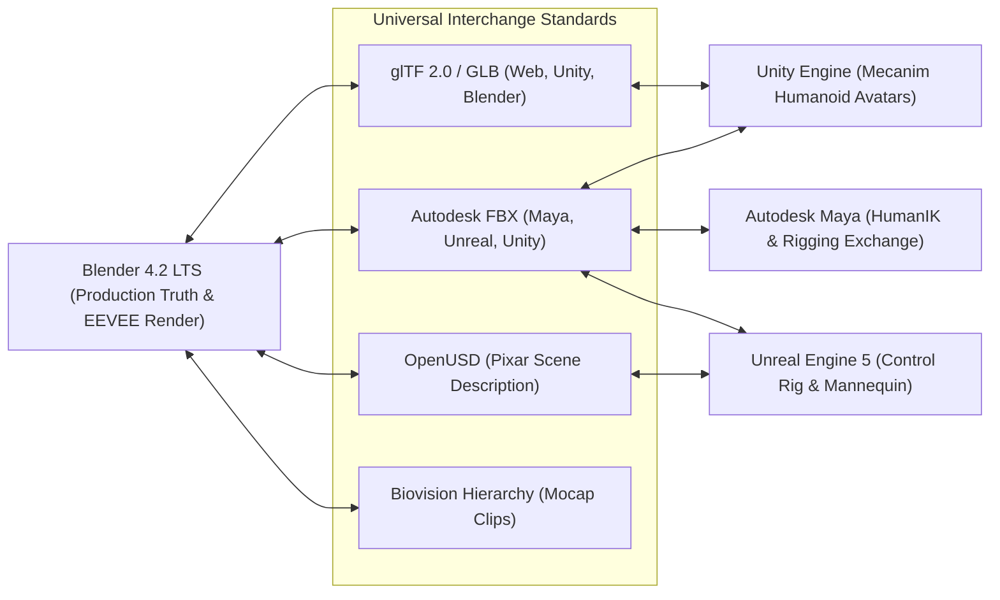

# Autonomous AI Cartoon Studio
## Animation Interoperability Plan (Blender, Maya, Unity & Unreal Engine) (V2.0)

---

### 1. Interoperability Goal & Scope

The **Animation Interoperability Layer** ensures that character models, skeletal rigs, morph targets, and animation clips created or ingested by the studio can be exported, imported, and exchanged smoothly across industry-standard 3D suites: **Blender**, **Autodesk Maya**, **Unity Engine**, and **Unreal Engine 5**.

---

### 2. Format Specification & Conversion Rules

| Standard Format | Target Ecosystem | Geometry & Normals | Skeletal Bones | Animation Tracks | Blendshapes |
|---|---|---|---|---|---|
| **glTF 2.0 / GLB** | Unity, WebGL, Sketchfab | Triangulated / Quads with Mikktspace tangents | Joint hierarchy with inverse bind matrices | Quaternion rotation & linear translation | ARKit 52 morph targets preserved |
| **Autodesk FBX (2020)** | Maya, Unreal Engine, Unity | Smoothing groups preserved | Null / Bone nodes with local transform Euler | Baked keyframes at 30 fps (no sub-frame drift) | Deformer shape keys exported |
| **OpenUSD (.usda / .usdz)**| Unreal Engine, Omniverse | USDGeomMesh | USDSkelAnimation & USDSkeleton | Time-sampled transforms | Blendshape weights |
| **BVH** | Motion Capture Libraries | N/A (Skeleton only) | Joint offset hierarchy | Euler rotation channels per frame | N/A |

---

### 3. Application-Specific Interchange Adapters

#### A. Blender ↔ Maya Interoperability
- **Joint Axis Alignment:** Maya's standard joint orientation is `X-Down-Bone` with `Y-Up`. Blender's bone axis is `Y-Down-Bone` with `Z-Up`.
- **Adapter Mechanism:** The `interchange_engine/maya_adapter.py` automatically multiplies bone matrix transformations by a -90° X-axis rotation matrix upon export/import, ensuring Maya HumanIK attaches without twisted limbs.
- **Skin Cluster Weights:** Preserves normalized 4-weight influences across Maya `skinCluster` deformers.

#### B. Blender ↔ Unity Humanoid Interoperability
- **Unity Mecanim Mapping:** Unity recognizes standard humanoid bone names (`Hips`, `Spine`, `Chest`, `UpperChest`, `LeftUpperArm`, etc.).
- **glTF / FBX Setup:** Assets destined for Unity are tagged with Unity Humanoid profiles, ensuring drag-and-drop animation retargeting inside Unity's Animator controller.

#### C. Blender ↔ Unreal Engine 5 Interoperability
- **UE5 Mannequin Alignment:** Bones map directly to `pelvis` -> `spine_01` -> `spine_02` -> `spine_03` -> `clavicle_l` -> `upperarm_l` -> etc.
- **Root Motion:** The root bone (`root`) stays grounded at `(0, 0, 0)` with planar forward translation, enabling Unreal's Root Motion Character Controller to execute locomotion without in-place slippage.
