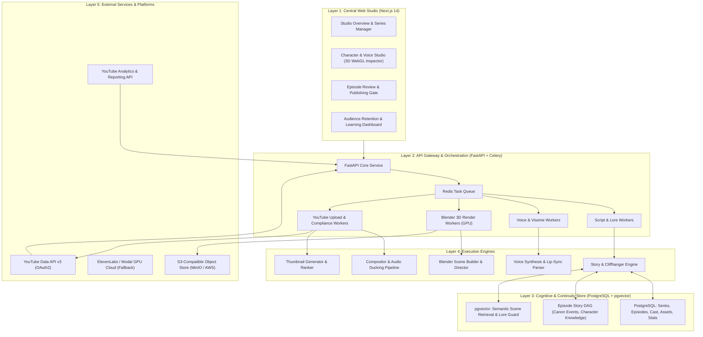
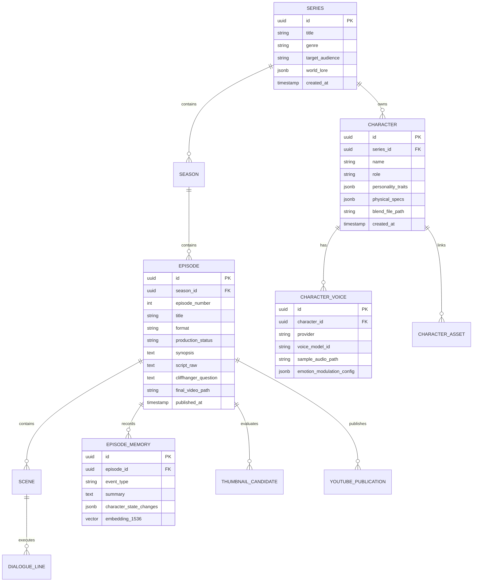
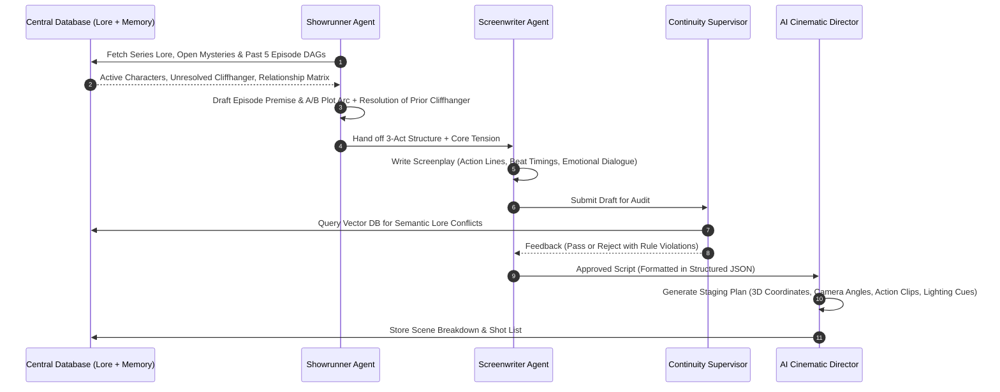
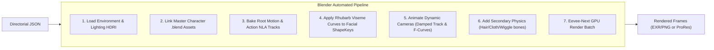
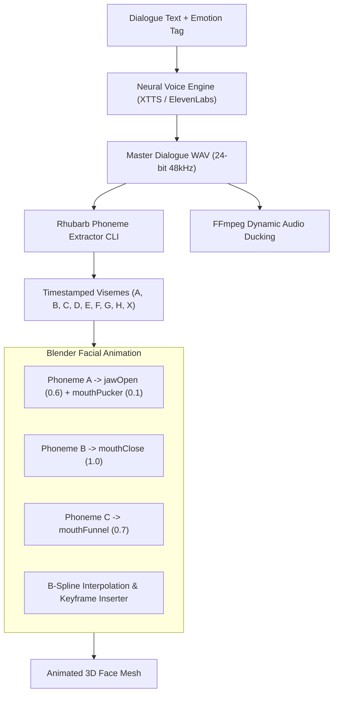
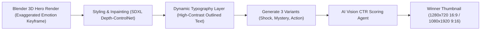
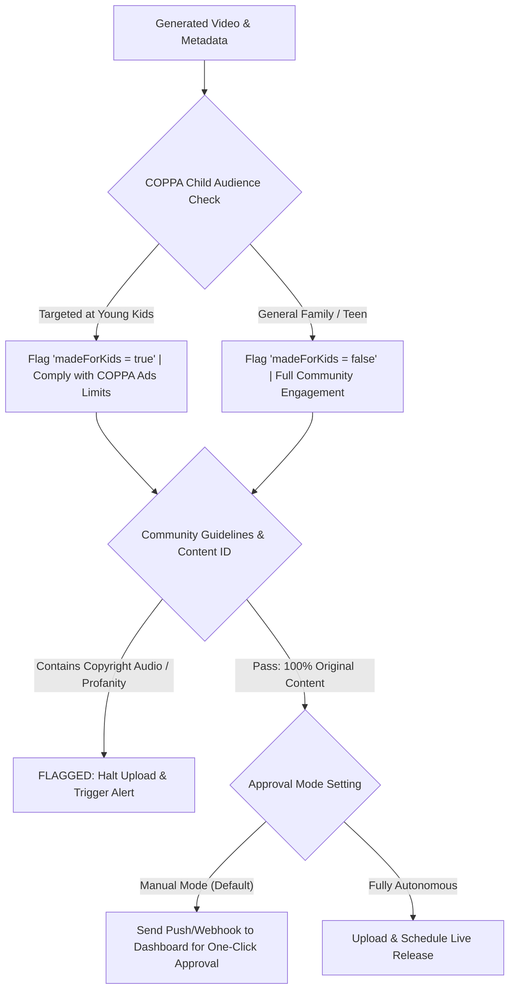

# Autonomous AI Cartoon Studio & YouTube Automation Platform
## Master Technical Architecture & Implementation Blueprint

---

## 1. Executive Summary & Engineering Philosophy

The objective is to architect and construct a fully autonomous, production-grade **Autonomous AI 3D Cartoon Production Studio**. Rather than relying on fragile 2D generative video models (which suffer from temporal flickering, identity drift, hallucinatory morphing, and lack of spatial control), this platform employs a **hybrid 3D generative-parametric pipeline**:
1. **Deterministic 3D World & Assets**: 3D character meshes, rigs, blendshapes, materials, and set environments orchestrated programmatically inside **Blender via its Python API (`bpy`)**. This guarantees **100% character identity preservation, zero temporal flickering, deterministic lighting, and true cinematic camera control**.
2. **Generative Intelligence Layer**: Multi-agent Large Language Models (LLMs) driving showrunning, episodic continuity memory, screenplay drafting, and shot-list directorial decisions.
3. **Neural Performance Layer**: Expressive multi-character neural text-to-speech (TTS), automated phoneme-to-viseme lip-synchronization, and procedural-plus-mocap skeletal motion blending.
4. **Autonomous Post-Production & Broadcast**: Headless Eevee-Next rendering, automated audio ducking/mixing, subtitle burning, multi-candidate thumbnail generation, YouTube API compliance validation, and performance-driven feedback loops.

```
                      +------------------------------------------+
                      |         CENTRAL WEB DASHBOARD            |
                      |   (Next.js 14 / Three.js / WebSockets)   |
                      +--------------------+---------------------+
                                           |
+------------------------------------------v------------------------------------------+
|                              ORCHESTRATION & API CORE                                |
|             FastAPI Application Server + Celery Distributed Task Queue               |
|                       Redis Message Broker + PostgreSQL + S3                         |
+-----+-------------------+-------------------+-------------------+-------------------+
      |                   |                   |                   |                   |
      v                   v                   v                   v                   v
+------------+     +------------+      +------------+     +------------+      +---------------+
|  STORY &   |     |  VOICE &   |      | 3D BLENDER |     | COMPLIANCE |      | YOUTUBE API   |
| CONTINUITY |     |  LIP-SYNC  |      | PRODUCTION |     | & POST-PRO |      | & ANALYTICS   |
|   ENGINE   |     |   ENGINE   |      |   ENGINE   |     |   ENGINE   |      |    ENGINE     |
+------------+     +------------+      +------------+     +------------+      +---------------+
| * Lore DB  |     | * XTTS/11L |      | * Headless |     | * FFmpeg   |      | * OAuth2 Flow |
| * DAG Mem  |     | * Rhubarb  |      |   Blender  |     |   Mixer    |      | * Metadata Gen|
| * Script   |     | * Viseme   |      | * ActionLib|     | * Eevee-N  |      | * Retention   |
|   Agent    |     |   Mapping  |      | * CameraDir|     | * Thumbnail|      |   Analyzer    |
+------------+     +------------+      +------------+     +------------+      +---------------+
```

---

## 2. Technology Selection & Feasibility Matrix

To balance high visual fidelity, low operational latency, and cost efficiency, we evaluate open-source, local-first components against cloud services:

| Component | Recommended Solution | Alternative Considered | Feasibility & Rationale |
| :--- | :--- | :--- | :--- |
| **3D Engine & Rendering** | **Blender 4.2+ Headless (`bpy` + Eevee-Next)** | Unreal Engine 5 / Unity | **100% Open Source / Scriptable.** Blender's Python API allows full programmatic control over scenes, rigs, materials, cameras, and Eevee-Next delivers stylized cartoon rendering in 8–15s per frame on RTX 4080/4090. |
| **Character Rigging** | **Rigify / Auto-Rig Pro + ARKit 52 Blendshapes** | Mixamo Auto-Rig only | **Production Standard.** Requires standard FACS / ARKit blendshapes (52 shape keys) for human-grade facial expressions and lip-sync. |
| **Motion Generation** | **Parametric Action Library + MDM / MotionDiffuse** | Pure Raw Keyframing | **Hybrid.** Curated library of 250+ base actions (walk, run, fight, emote) retargeted dynamically via bone mapping + procedural physics. |
| **Lip Synchronization** | **Rhubarb Lip Sync + Blender ShapeKey Driver** | Wav2Lip / SadTalker | **Geometric 3D Accuracy.** Rhubarb derives exact phonemes (A, B, C, D, E, F, G, H, X) from audio in real-time, driving true 3D mouth shapekeys directly without 2D video artifacts. |
| **Neural Voice Engine** | **F5-TTS / Coqui XTTS v2 (Local) or ElevenLabs (Cloud)** | Bark / Tortoise-TTS | **Expressive Continuity.** Voice identity preserved via reference audio embeddings + SSML/emotion prompting for screaming, whispering, and crying. |
| **Script & Continuity** | **Multi-Agent LLM (Gemini 1.5 Pro / GPT-4o) + pgvector** | Single-prompt LLM | **Critical for Zero-Hallucination.** Showrunner, Screenwriter, Continuity Supervisor, and Cliffhanger agents coordinate via a persistent graph database. |
| **Audio Mixing & Post** | **FFmpeg + PyDub (Sidechain Ducking + SFX Library)** | DaVinci Resolve CLI | **Lightweight & Headless.** Programmatic audio normalization (EBU R128), dynamic background ducking, and subtitle rendering. |
| **Thumbnail Engine** | **Blender 3D Hero Render + SDXL/Flux ControlNet Depth + PIL** | Pure Canvas/Photoshop | **Consistency & High CTR.** Characters are rendered in 3D hero poses, enhanced with stylized depth-guided diffusion, and composited with high-contrast typography. |
| **Backend & Workers** | **FastAPI + Celery + Redis + PostgreSQL** | Node.js / Express | **Heavy Workload Resilience.** Native Python integration with `bpy`, PyTorch, and FFmpeg. |
| **Frontend Dashboard** | **Next.js 14 + Tailwind CSS + Three.js Viewer** | Streamlit / Gradio | **Commercial Studio Grade.** Full series management, 3D web asset inspection, manual review overrides, and analytics charts. |

---

## 3. High-Level System Architecture

The architecture is divided into six decoupled, independently scalable layers:



---

## 4. Database Architecture & Continuity Memory

To prevent characters from contradicting established lore, forgetting past interactions, or suffering personality drift, we implement a **Triple-Tier Memory Architecture**:
1. **Relational Schema**: Manages series metadata, episode numbering, assets, render tasks, and analytics.
2. **Lore & Relationship Graph (DAG)**: Tracks character relationships (e.g., *Alice trusts Bob*, *Bob hides the secret map from Alice*), item ownership, and world facts across seasons.
3. **Semantic Vector Index**: Stores previous scene transcripts and emotional turning points for contextual retrieval during script writing.

### PostgreSQL Relational & Vector Schema



---

## 5. AI Story & Script Intelligence Engine

The Story Engine operates as a hierarchical multi-agent loop with strict verification steps:



### Script Output Schema (Structured JSON Example)
```json
{
  "episode_id": "ep_102_secret_cave",
  "series_id": "series_shadow_island",
  "cliffhanger_question": "Who just locked the cave entrance from the outside?",
  "scenes": [
    {
      "scene_index": 1,
      "environment_preset": "dark_crystal_cave",
      "lighting_mood": "mysterious_bioluminescent_cyan",
      "duration_seconds": 18.5,
      "camera_shots": [
        {
          "shot_type": "ESTABLISHING_TRACKING",
          "start_pos": [-4.0, -8.0, 2.5],
          "end_pos": [-1.0, -4.0, 1.8],
          "target_focus": "hero_character_leo",
          "focal_length_mm": 35.0
        }
      ],
      "actions": [
        {
          "character_id": "hero_leo",
          "action_name": "torch_walk_cautious",
          "start_second": 0.0,
          "end_second": 8.0,
          "root_path": [[-2.0, 0.0], [0.0, 2.5]]
        }
      ],
      "dialogues": [
        {
          "speaker_id": "hero_leo",
          "text": "Look at these wall carvings, Maya. This isn't natural... someone built this.",
          "emotion": "whisper_awe",
          "start_second": 2.5,
          "viseme_file": "ep102_s1_d1_visemes.json"
        }
      ]
    }
  ]
}
```

---

## 6. 3D Character Creation, Rigging & Asset Standards

To achieve Pixar/DreamWorks-level stylized 3D animation without per-frame AI hallucination:
1. **Geometric Identity Guarantee**: Each character exists as a master `.blend` asset containing:
   - Optimized Quad Topology (25,000–45,000 polys for real-time Eevee viewport performance).
   - Stylized PBR / NPR Toon Shader with customizable line art (`Freestyle` / `Grease Pencil LineArt`).
   - Symmetrical Skeletal Deform Rig (Rigify human/creature metarig with IK/FK switching).
   - Facial Blendshapes: **52 ARKit / FACS Standard ShapeKeys** enabling full emotional fidelity:
     - `jawOpen`, `mouthPucker`, `mouthFunnel`, `mouthSmileLeft`, `mouthSmileRight`
     - `eyeBlinkLeft`, `eyeBlinkRight`, `eyeSquint`, `browInnerUp`, `browDownLeft`
     - `cheekPuff`, `noseSneer`, etc.
2. **Action Clip Library**:
   - Master library of loopable, normalized actions:
     - Locomotion: `walk_neutral`, `walk_stealth`, `run_panicked`, `sprint_heroic`
     - Interactions: `torch_hold`, `pick_up_ground`, `climb_ledge`, `sit_chair`, `point_forward`
     - Emotes: `laugh_boisterous`, `cry_hands_on_face`, `shock_jump_back`, `angry_chest_puff`
     - Combat: `punch_cross`, `kick_roundhouse`, `block_shield`, `dodge_roll`
3. **Modular Costume & Prop Attachment**:
   - Outfits parented via bone constraints (`Armature Deform with Empty Groups` or `Surface Deform`).
   - Sockets for handheld items (`hand_prop.L`, `hand_prop.R`, `backpack_mount`).

---

## 7. Autonomous 3D Animation & Scene Assembly Workflow

The automated animation engine operates headlessly inside Blender using custom Python automation scripts (`bpy`):



### Key Technical Innovations in Blender Automation:
- **Non-Linear Animation (NLA) Stacking**: Actions are pushed into NLA tracks with cubic ease-in/ease-out transitions, eliminating robotic jerks between walking, jumping, and stopping.
- **Automated Cinematographer**:
  - The script calculates bounding boxes of active speaking characters.
  - Generates primary cameras with focal length selections (35mm for environmental establishing, 85mm for emotional close-ups with depth of field bokeh).
  - Implements procedural camera breathing and handheld shake using Perlin noise F-Curves.
- **Dynamic Gaze & Head IK Tracking**: While speaking or moving, character head bones are constrained to look at the dialogue partner's head socket with realistic saccadic eye movements.

---

## 8. Expressive Voice, Dialogue & Lip-Sync Pipeline



### Multilingual & Localization Support:
- Text is translated by the localization agent preserving colloquial dialogue timing.
- Character voice embeddings (128-dim voice timbre vector) are passed directly to multilingual synthesis models, guaranteeing the **exact same vocal identity** whether speaking English, Spanish, Hindi, or Japanese.

---

## 9. Automated Video Post-Production & Sound Design

Once 3D frames are rendered, the **Autonomous Post-Production Pipeline** executes:
1. **Frame Assembly**: Direct lossless FFmpeg video encoding (H.264 / ProRes 422).
2. **Audio Stems Conductor**:
   - **Stem 1: Dialogue**: Pristine voice tracks with high-pass filter (80Hz cut) and compressor.
   - **Stem 2: Foley & SFX**: Automated cue matching from Directorial JSON (footsteps matched to ground-contact animation frames, ambient wind/cave drips, combat hits).
   - **Stem 3: Dynamic Score**: Mood-specific musical cues (adventure, suspense, comedy) licensed from pre-cleared libraries or generated via Suno/MusicLM.
3. **Dynamic Sidechain Ducking**: The music stem is automatically attenuated by -14dB whenever dialogue presence is detected, restoring full volume during dramatic visual beats.
4. **Automated Subtitle Engine**: Generates stylized, word-level highlighted subtitles (YouTube Shorts style or clean cinematic subtitles) rendered directly onto the video.
5. **Quality Assurance Check**:
   - Automated scan for black frames, audio clipping (> 0 dBFS), or missing animation frames.

---

## 10. AI Thumbnail Generation & CTR Engine

Thumbnails represent 70%+ of YouTube discovery success. Rather than generating random images, the thumbnail engine produces **canonical 3D scene renders**:



- **Facial Expression Optimization**: Character eyebrows raised, eyes widened, mouth open in shock or intrigue.
- **Rule of Thirds**: Focal subject occupies 40–55% of the frame canvas with high foreground-background separation.
- **CTR Validation**: Multi-modal vision agent scores visual appeal, clarity at mobile scale, and emotional resonance before final selection.

---

## 11. Autonomous YouTube Publishing & Monetization Compliance

### YouTube Data API v3 Workflow
- Secure OAuth2 token storage in PostgreSQL with automated refresh token rotation.
- Resumable chunked video upload pipeline handling network hiccups gracefully.
- Automatic playlist allocation based on series and season identifiers.
- Multi-language caption track uploading.

### Monetization Policy & COPPA Compliance Gate:



---

## 12. AI Performance, Retention & Learning Engine

The studio doesn't just produce videos—it gets smarter with every release:
1. **Analytics Ingestion (Hourly/Daily via YouTube Analytics API)**:
   - Click-Through Rate (CTR).
   - Audience Retention Curve (second-by-second drop-off points).
   - Average Percentage Viewed (APV).
   - New vs. Returning Viewers.
2. **Drop-Off Forensic Analysis**:
   - If audience drops at 0:15 in Episode 3, the engine correlates this timestamp with the Directorial JSON (e.g., *Scene 2 dialogue was too slow or monologue was too long*).
3. **Adaptive Prompt Tuning**:
   - The feedback is ingested into the **Showrunner & Screenwriter Agent system prompt for subsequent episodes**, prompting faster scene transitions, punchier jokes, or more frequent action beats.

---

## 13. Infrastructure, GPU Requirements & Operational Costs

### Hardware & Infrastructure Profile:
- **Development & Single-Worker Studio**:
  - 1x Host PC with NVIDIA RTX 3080/4080/4090 (24GB VRAM recommended for Eevee-Next + local TTS).
  - 64GB RAM, Fast 2TB NVMe SSD.
- **Scaled Production Cloud Setup**:
  - RunPod / Vast.ai / Lambda Labs On-Demand: 1x RTX 4090 ($0.45 - $0.69/hr) or A10G/L4 ($0.50 - $0.80/hr).
  - Supabase / Managed PostgreSQL + MinIO Object Store.

### Estimated Operational Cost Breakdown

#### Mode A: 100% Local / Open-Source Pipeline (Self-Hosted GPU)
- Script Generation: Gemini 1.5 Flash API or local Ollama: **~$0.02 / episode**
- Voice Synthesis: Coqui XTTS v2 / F5-TTS (Local GPU): **$0.00**
- 3D Animation & Rendering: Blender Headless Eevee (Local GPU): **$0.00**
- Post-Production & Thumbnails: FFmpeg + SDXL Local: **$0.00**
- **Total Cost per 5-Minute Episode**: **~$0.05 - $0.15** (Electricity & minimal API)
- **Total Cost per 60-Second Short**: **~$0.02**

#### Mode B: Hybrid Cloud Pipeline (Fastest, Commercial Quality)
- Script & Continuity: Claude 3.5 Sonnet / GPT-4o: **$0.25 / episode**
- Voice Synthesis: ElevenLabs Professional Tier (approx. 750 words): **$0.80 / episode**
- Cloud GPU Rendering: RunPod RTX 4090 (15 min render time): **$0.18 / episode**
- Post & Storage: S3 + Celery Cloud: **$0.05 / episode**
- **Total Cost per 5-Minute Episode**: **~$1.28 - $2.50**
- **Total Cost per 60-Second Short**: **~$0.30 - $0.60**

---

## 14. 10-Phase Development Roadmap

```mermaid
gantt
    title Autonomous Cartoon Studio Engineering Roadmap
    dateFormat  YYYY-MM-DD
    section Phase 1 to 3: Core Foundation
    P1: Foundation & DB Schema Setup        :active, 2026-03-01, 7d
    P2: LLM Story Engine & Lore Memory      :2026-03-08, 10d
    P3: 3D Character Master Assets & Rigs   :2026-03-18, 12d
    section Phase 4 to 6: Animation & Audio
    P4: Voice Synthesis & Rhubarb Lip-Sync  :2026-03-30, 8d
    P5: Headless Blender 'bpy' Scene Director:2026-04-07, 14d
    P6: Sound Design & FFmpeg Post-Compositor:2026-04-21, 8d
    section Phase 7 to 10: Publishing & Intelligence
    P7: AI Thumbnail Generator & CTR Rater  :2026-04-29, 7d
    P8: YouTube API & Compliance Pipeline   :2026-05-06, 8d
    P9: Web Studio Dashboard (Next.js)      :2026-05-14, 12d
    P10: Analytics Feedback Loop & E2E Test :2026-05-26, 10d
```

### Detailed Phase Breakdown:
- **Phase 1: Foundation & Infrastructure**: Project scaffolding, FastAPI server, PostgreSQL schema, Redis/Celery queue setup, environment isolation in `e:\YT`.
- **Phase 2: Story & Lore Memory Engine**: Implementation of Showrunner, Screenwriter, Continuity Supervisor agents with pgvector memory.
- **Phase 3: Character Studio & Rig Standards**: Standardizing master 3D character specifications, Rigify skeleton mapping, ARKit 52 shapekey verification.
- **Phase 4: Neural Voice & Lip-Sync Engine**: XTTS/ElevenLabs voice generation, audio normalization, Rhubarb CLI integration for viseme extraction.
- **Phase 5: Autonomous Blender Directorial Engine (`bpy`)**: Automated environment building, NLA action blending, dynamic camera framing, and Eevee-Next headless rendering.
- **Phase 6: Video Assembly & Audio Ducking**: FFmpeg headless video/audio compositor, sidechain music ducking, automated subtitle burning.
- **Phase 7: Thumbnail Studio**: Automated Blender hero pose snapshot, ControlNet background styling, bold typography rendering.
- **Phase 8: YouTube Publishing & Policy Gate**: OAuth2 authentication, resumable uploader, COPPA compliance checklist, manual/auto approval switch.
- **Phase 9: Central Web Dashboard**: Next.js 14 control center, real-time job status via WebSockets, Three.js character preview, script editor.
- **Phase 10: Performance Learning & End-to-End Validation**: Ingestion of YouTube Analytics, continuous prompt improvement, full end-to-end pilot episode generation.

---

## 15. Testing Strategy & Failure Recovery

1. **Deterministic Test Suites**:
   - **Story Consistency Unit Tests**: Pass contradictory premise (e.g., *character killed in Ep 1 appears in Ep 2*) to verify Continuity Supervisor rejection.
   - **Viseme Alignment Test**: Verify shapekey activation timing matches audio phoneme timestamps within +/- 1 frame (33ms at 30fps).
   - **Blender Headless Render Stress Test**: 100-frame render benchmark verifying zero unhandled GPU memory leaks or missing texture links.
2. **Resilience & State Recovery**:
   - Each production step writes its artifacts (`script.json`, `audio_stems/`, `raw_frames/`, `final_cut.mp4`) to disk before triggering the next task.
   - If rendering fails midway due to a GPU hiccup, Celery restarts only from the failed scene, preventing costly regeneration of scripts or voices.
   - Duplicate upload prevention: Hashes of final video files are verified against published database records before invoking YouTube upload.

---

## 16. Technical Decision Checklist for User Approval

Before writing code in `e:\YT`, please review and confirm the core architectural choices:

1. **Rendering Platform**: Confirm Blender 4.2+ Headless with Eevee-Next (recommended for rapid cartoon rendering) vs Cycles (higher compute, longer render times).
2. **Voice Generation Preference**:
   - **Option A (Hybrid Recommended)**: Local Coqui XTTS v2 / F5-TTS for development & zero-cost testing, with ElevenLabs API toggle for production releases.
   - **Option B (100% Local)**: Strictly local open-source models (zero API fees, requires local GPU).
3. **Publishing Safety Default**: Confirm starting in **Manual Review Gate Mode** (AI generates entire episode and alerts you on dashboard for 1-click approval before YouTube publishing).
4. **Primary Project Target**: Confirm first pilot series format (e.g., a 60-second YouTube Short pilot or a 3-minute episode pilot) to validate the end-to-end loop during Phase 1–5.
