# Autonomous AI Cartoon Studio
## Complete 3D Asset Ecosystem & Sketchfab-Style Asset Browser Specification (V2.0)

---

### 1. Vision & Architectural Scope

The **Complete 3D Asset Ecosystem** is a centralized, local-first asset management repository and Sketchfab-style 3D browser embedded into the Autonomous AI Cartoon Studio. It allows autonomous agents and human directors to search, filter, preview in 3D WebGL, validate, and dynamically instantiate assets into Blender scenes.

```mermaid
flowchart TD
    subgraph Repositories ["Asset Acquisition Sources"]
        R1["Procedural Engines (MPFB2, TreeGen)"]
        R2["CC0 Asset Stores (Poly Haven)"]
        R3["Standard 3D Formats (GLB, glTF, FBX, OBJ, USD)"]
        R4["Internal Character Creations & Rigs"]
    end

    subgraph Pipeline ["Ingestion & Validation Pipeline"]
        V_License["License & Commercial Permitted Auditor"]
        V_Format["Format Normalizer & glTF/GLB Converter"]
        V_Geom["Topology & Polygon Density Checker"]
        V_Mat["PBR Material & Texture Packer"]
        V_Thumb["Automated 3D WebGL & 2D Thumbnail Render"]
    end

    subgraph Storage ["Asset Directory Organization (E:\YT\assets\)"]
        A_Char["assets/characters/"]
        A_Anim["assets/animals/"]
        A_Rig["assets/skeletons/ & assets/rigs/"]
        A_Motion["assets/animations/ & motion_capture/"]
        A_Env["assets/environments/"]
        A_Prop["assets/props/"]
        A_Mat["assets/materials/ & textures/ & hdris/"]
        A_Audio["assets/audio/ (voices, music, sfx)"]
    end

    subgraph Browser ["Sketchfab-Style Internal Asset Browser"]
        SearchFilter["Faceted Search (Tags, Polycount, Rig Family)"]
        Inspector3D["Interactive 3D WebGL Viewer (Three.js / Babylon.js)"]
        MetaCard["Full Metadata & Commercial License Badge"]
        OneClick["1-Click Scene Instantiation Bridge"]
    end

    Repositories --> Pipeline
    Pipeline --> Storage
    Storage --> Browser
```



---

### 2. Comprehensive Asset Categorization & Standards

#### A. Character Library
- **Human Characters:** Adult male/female, young boy (Leo), young girl (Aria), elderly characters.
- **Stylized & Cartoon:** Pixar/Disney feature-animation proportions (large expressive eyes, stylized silhouette).
- **Fantasy & Robotic:** Golems, androids, fantasy beings.
- **Topology Requirement:** Clean quad topology (15,000 to 45,000 polygons for hero characters, 3,000 to 8,000 polygons for background crowds).

#### B. Animal & Creature Library
- **Domestic & Wild Quadrupeds:** Dogs, cats, horses, wolves, bears.
- **Fantasy Companions:** Glowing magical foxes (Lumi), dragons, winged familiars.
- **Rig Integration:** Full quadruped bone mapping with tail dynamic secondary motion.

#### C. Skeleton and Rig Library
- Universal Humanoid Rigs (Rigify Metarigs, Mixamo 52-Bone, Unity Humanoid).
- Quadruped Skeletons (Canine, Feline, Equine).
- Avian Skeletons (Wing flap, folding, flight control).
- Facial Rigs: ARKit 52 blendshape standard + jaw bone control.

#### D. Animation Library (250+ Parametric Actions)
- **Locomotion:** Walking, running, sneaking, jumping, landing, climbing, swimming.
- **Emotional Acting:** Crying, laughing, cheering, trembling with fear, standing in awe.
- **Gestures & Combat:** Pointing forward, waving, fist pumps, swinging tools, defensive blocks.
- **Object Interaction:** Picking up props, carrying backpacks, drinking, opening doors.

#### E. Environment Library
- **Natural Biomes:** Caverns with glowing crystal spires, mushroom forests, alpine meadows, rivers.
- **Constructed Spaces:** Cozy village cottages, fantasy ruins, ancient bridges, spaceship interiors.
- **Lighting & Atmosphere:** Volumetric fog volumes, particle atmospheric spawners, HDRI domes.

#### F. Props & Objects
- Vehicles, ancient torches, backpacks, crystals, cooking utensils, furniture, ancient scrolls.

#### G. Materials, Shaders & Textures
- **PBR Textures:** Base Color, Roughness, Metallic, Normal (OpenGL/DirectX), Ambient Occlusion, Height.
- **Subsurface Scattering (SSS):** Skin shader with epidermal/subdermal dual scattering.
- **Specialty Shaders:** Translucent refractive ice/crystal, velvet/fabric sheen, glossy eye cornea with dark pupil depth.

#### H. Audio Assets
- Local neural speech profiles (Leo, Lumi, Aria, Elder, Narrator).
- High-fidelity environmental ambiances (cavern drone, wind, running water, forest birds).
- Cinematic score stems and rhythmic orchestral tracks.

---

### 3. Unified Asset Metadata Standard (JSON-Schema)

Every asset ingested into the studio carries an immutable `asset.json` manifest:

```json
{
  "asset_id": "char_leo_pixar_hero_v2",
  "name": "Leo - Stylized Cartoon Boy",
  "category": "characters/humanoid/child",
  "version": "2.0.0",
  "format": "gltf",
  "source_file": "assets/characters/leo_hero.glb",
  "preview_thumbnail": "assets/characters/previews/leo_thumb.jpg",
  "preview_3d_glb": "assets/characters/previews/leo_webgl.glb",
  "geometry": {
    "polygon_count": 28450,
    "vertex_count": 29120,
    "topology_type": "quad_dominant",
    "is_watertight": true
  },
  "rigging": {
    "has_armature": true,
    "rig_family": "universal_humanoid",
    "bone_count": 52,
    "adapter_name": "mixamo_standard",
    "has_facial_blendshapes": true,
    "blendshape_standard": "arkit_52"
  },
  "materials": [
    {"name": "PixarSkin", "shader": "Principled_BSDF", "sss_weight": 0.25},
    {"name": "RedHoodie", "shader": "Fabric_Roughness_0.70"},
    {"name": "BlueJeans", "shader": "Denim_Roughness_0.65"}
  ],
  "licensing": {
    "license": "CC0",
    "author": "Autonomous Cartoon Studio",
    "commercial_use_permitted": true,
    "attribution_required": false
  }
}
```
