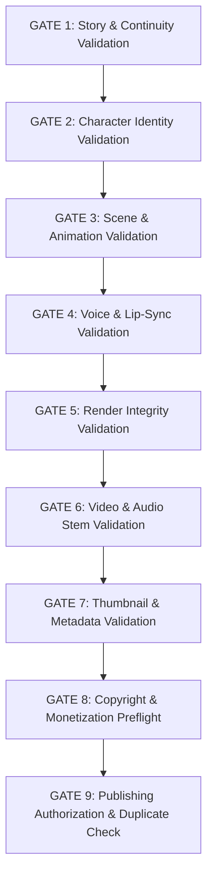

# Autonomous AI Cartoon Studio
## Autonomous 24-Step Production Workflow & 9-Gate Quality Assurance Protocol

---

## 1. The Autonomous 24-Step Production Loop

The studio operates on a fully closed, autonomous loop without requiring routine human intervention:

```
[1. Select Production Concept] ──> [2. Retrieve Series Memory] ──> [3. Plan Story Arc]
                 │
                 ▼
[4. Draft Directorial Script] ──> [5. Validate Continuity] ──> [6. Load Character Rigs]
                 │
                 ▼
[7. Assemble 3D Scene Assets] ──> [8. Synthesize Dialogue] ──> [9. Apply Retargeted Mocap]
                 │
                 ▼
[10. Compute Facial Acting] ───> [11. Lip-Sync Calibration] ──> [12. Direct Cinematic Cameras]
                 │
                 ▼
[13. Render 3D GPU Frames] ────> [14. Quality Inspection] ───> [15. Self-Correction / Retry]
                 │
                 ▼
[16. FFmpeg Assembly & Ducking]─> [17. Extract Shorts] ───────> [18. Create High-CTR Thumbnails]
                 │
                 ▼
[19. Generate SEO Metadata] ───> [20. Compliance Preflight] ──> [21. YouTube Publishing Gate]
                 │
                 ▼
[22. Update Series Canon DB] ──> [23. Scrape Analytics] ─────> [24. Adaptive Creative Learning]
```

---

## 2. The 9 Mandatory Quality Inspection Gates

An episode cannot be assembled or published without passing all 9 inspection gates. If a gate fails, the system executes an automated self-correction routine:



### Gate Breakdown & Automated Self-Correction Protocol:

| Gate | Validation Focus | Failure Condition | Automated Correction Routine |
| :--- | :--- | :--- | :--- |
| **GATE 1** | Story & Continuity | Unresolved prior cliffhanger; contradiction of established canon. | Prompt Continuity Supervisor to reject draft and re-generate scenes with enforced canon constraints. |
| **GATE 2** | Character Identity | Mesh topology drift; unassigned rig; altered clothing textures. | Re-link master character asset from `assets/characters/<id>_master.blend` and restore default material tree. |
| **GATE 3** | Scene & Animation | Mesh clipping through objects; foot sliding; broken IK bones. | Apply foot-contact constraint modifier and re-bake armature action NLA tracks. |
| **GATE 4** | Voice & Lip-Sync | Missing dialogue stem; viseme timing offset > 33ms (1 frame). | Re-run Rhubarb acoustic aligner and re-bake F-Curves to facial shapekeys. |
| **GATE 5** | Render Integrity | Black frames; corrupted PNGs; missing texture links. | Isolate failing frame indices and re-render only the affected sub-batch. |
| **GATE 6** | Video & Audio | Dialogue clipping (>0 dBFS); music overpowering speech; stutter. | Re-run FFmpeg sidechain compression filter with -14dB dialogue ducking and normalize to EBU R128 (-14 LUFS). |
| **GATE 7** | Thumbnail & Metadata | Illegible text; title > 100 characters; misleading scene. | Trigger Thumbnail Studio to re-render secondary candidate with boosted outline contrast. |
| **GATE 8** | Policy & Copyright | Prohibited words; Content ID audio match; COPPA misclassification. | Preflight scan flags issue; automatically adjust audience classification flag and sanitize metadata. |
| **GATE 9** | Publishing & Duplication | Duplicate video hash; exhausted YouTube daily API quota. | Hash comparison against `publishing_records` ledger; if quota is reached, hold video in `episodes/planned/` until quota resets. |

---

## 3. Operational Publishing Modes

The studio supports two operational modes:

### Mode A: Fully Autonomous Operation (Target State)
1. Studio continuously executes the weekly production calendar.
2. Upon passing Gate 9, the video is autonomously uploaded to the linked YouTube channel, assigned to the correct series playlist, and scheduled for public broadcast.
3. Post-launch analytics are scraped 24 hours later to feed the Creative Learning Loop.

### Mode B: Manual Creator Review Gate (Initial Safe State)
1. Studio independently conceives, voices, animates, renders, edits, and packages the complete video, thumbnail, and metadata.
2. The finished package is displayed on the **Central Web Dashboard** with a **"1-Click Approve & Publish"** button.
3. Creator reviews the finished video in the web player and approves release.
