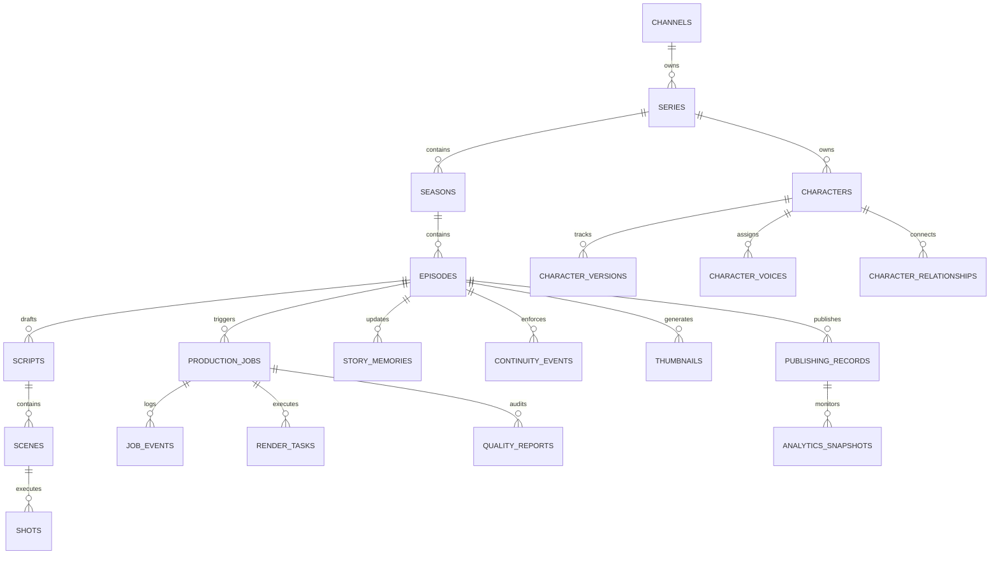

# Autonomous AI Cartoon Studio
## Normalized Database & Memory Architecture Specification

**Engine Target:** PostgreSQL (Production) / SQLite via `aiosqlite` (Local-First Development)  
**Schema Model:** Normalized Relational Database with Indexed JSONB Attributes  

---

## 1. Relational Entity-Relationship Diagram

---

## 2. Core Entity Definitions (29 Normalized Tables)

### Group 1: Studio, Channels & Series
1. **`users`**: Platform administrators, API owners, and role permissions (`id`, `username`, `email`, `role`, `created_at`).
2. **`channels`**: Linked YouTube channels (`id`, `user_id`, `youtube_channel_id`, `channel_name`, `oauth_token_encrypted`, `refresh_token_encrypted`, `quota_used_today`, `is_active`).
3. **`series`**: Cartoon series universes (`id`, `channel_id`, `title`, `description`, `genre`, `target_audience`, `art_style_preset`, `world_lore`, `created_at`).
4. **`seasons`**: Production seasons (`id`, `series_id`, `season_number`, `title`, `story_arc_summary`, `created_at`).
5. **`episodes`**: Episodic production records (`id`, `season_id`, `episode_number`, `title`, `format`, `target_duration_seconds`, `status`, `synopsis`, `cliffhanger_question`, `next_episode_teaser`, `final_video_path`, `primary_thumbnail_path`, `created_at`, `published_at`).

### Group 2: Character Identity & Assets
6. **`characters`**: Master recurring character records (`id`, `series_id`, `name`, `role`, `age_category`, `personality_summary`, `speaking_style`, `background_story`, `blend_model_path`, `rig_type`, `created_at`).
7. **`character_versions`**: Immutable version snapshots of character geometry and textures (`id`, `character_id`, `version_number`, `mesh_hash`, `texture_manifest`, `change_rationale`, `created_at`).
8. **`character_voices`**: Permanent character voice identities (`id`, `character_id`, `provider`, `voice_identifier`, `pitch_adjustment`, `rate_adjustment`, `volume_adjustment`, `emotion_presets`, `sample_audio_path`).
9. **`character_relationships`**: Inter-character affinity and dynamic knowledge graph (`id`, `character_id`, `target_character_id`, `relationship_type`, `affinity_score`, `shared_secrets`, `updated_at`).

### Group 3: Screenplay, Scenes & Cinematography
10. **`scripts`**: Episode screenplays (`id`, `episode_id`, `version`, `synopsis`, `screenplay_raw`, `script_structured`, `continuity_approved`, `created_at`).
11. **`scenes`**: Scene divisions (`id`, `script_id`, `scene_index`, `environment_id`, `lighting_preset`, `duration_seconds`).
12. **`shots`**: Individual cinematic camera shots (`id`, `scene_id`, `shot_index`, `shot_type`, `camera_start_pos`, `camera_end_pos`, `focal_length_mm`, `target_focus_character_id`).
13. **`environments`**: Reusable 3D environment assets (`id`, `series_id`, `name`, `theme`, `blend_file_path`, `lighting_rig_preset`, `created_at`).
14. **`props`**: Reusable 3D objects and handheld items (`id`, `series_id`, `name`, `category`, `blend_file_path`, `attachment_socket`).

### Group 4: Assets & Media
15. **`animation_assets`**: Pre-rigged reusable motion clips (`id`, `name`, `category`, `bvh_file_path`, `duration_seconds`, `is_loopable`).
16. **`audio_assets`**: Foley, sound effects, and pre-cleared musical cues (`id`, `name`, `category`, `audio_file_path`, `license_type`, `duration_seconds`).
17. **`video_assets`**: Rendered scene sequences and intermediate video stems (`id`, `episode_id`, `scene_id`, `video_file_path`, `resolution`, `fps`, `codec`).
18. **`thumbnails`**: Generated thumbnail candidates and selected heroes (`id`, `episode_id`, `variant_number`, `image_path`, `expression_tag`, `headline_text`, `ctr_vision_score`, `is_selected`).

### Group 5: Orchestration, Workers & Quality Control
19. **`production_jobs`**: Master orchestration job tracking (`id`, `episode_id`, `current_state`, `priority`, `retry_count`, `started_at`, `completed_at`, `error_log`).
20. **`job_events`**: Immutable timeline of execution events and transitions (`id`, `job_id`, `event_type`, `state_from`, `state_to`, `payload`, `timestamp`).
21. **`render_tasks`**: Granular Blender frame render batches (`id`, `job_id`, `scene_id`, `start_frame`, `end_frame`, `status`, `render_time_seconds`, `output_dir`).
22. **`quality_reports`**: Output of the 9-Gate Quality Control Engine (`id`, `job_id`, `gate_number`, `gate_name`, `passed`, `violation_details`, `auto_corrected`, `audited_at`).

### Group 6: Story Continuity & Episodic Memory
23. **`story_memory`**: Permanent canon events, discovered items, and character state changes (`id`, `episode_id`, `event_category`, `summary`, `character_state_changes`, `item_state_changes`, `unresolved_mystery`, `is_resolved`).
24. **`continuity_events`**: Strict world-rule constraints preventing plot contradictions (`id`, `series_id`, `rule_type`, `description`, `established_in_episode_id`, `is_active`).

### Group 7: YouTube Publishing & Channel Growth
25. **`publishing_records`**: Persistent upload ledger preventing duplicate publishing (`id`, `episode_id`, `youtube_video_id`, `youtube_url`, `title`, `description`, `tags`, `privacy_status`, `made_for_kids`, `upload_status`, `published_at`).
26. **`analytics_snapshots`**: Scraped YouTube performance metrics (`id`, `publishing_record_id`, `views`, `watch_time_minutes`, `average_view_duration_seconds`, `ctr_percent`, `retention_drop_timestamps`, `recorded_at`).

### Group 8: Registry, Governance & Audit
27. **`model_registry`**: Active local AI models and checkpoints (`id`, `model_type`, `model_name`, `model_path`, `parameters_count`, `hardware_target`, `is_loaded`).
28. **`repository_registry`**: Inventory of the 22 third-party repositories (`id`, `repo_name`, `repo_url`, `pinned_commit`, `license_type`, `integration_tier`, `audit_status`).
29. **`audit_logs`**: System security and configuration change log (`id`, `action`, `actor`, `ip_address`, `details`, `timestamp`).
