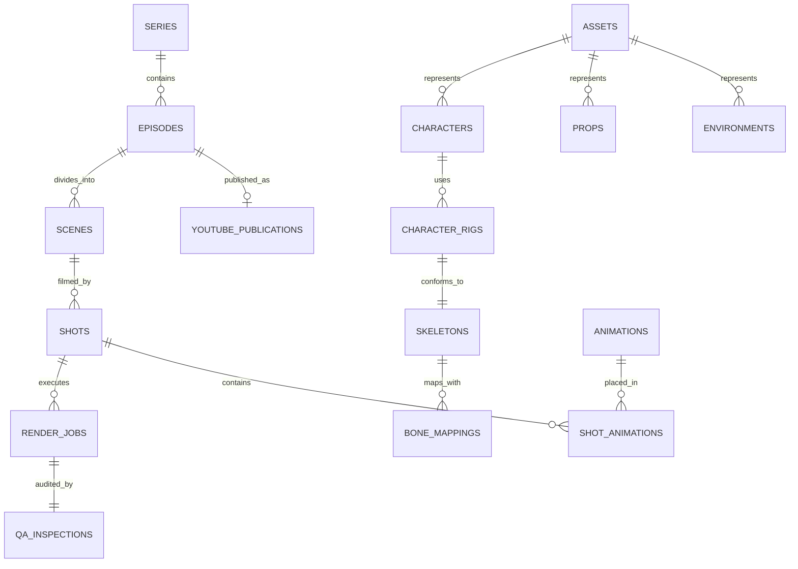

# Autonomous AI Cartoon Studio
## Database Schema Specification (SQLite / Relational Model V2.0)

---

### 1. Database Architecture & ER Diagram

The studio operates on a durable local SQLite database (`data/studio_v2.db`) with Foreign Key constraints enabled, Write-Ahead Logging (WAL) mode for concurrent access, and indexed lookup fields.



---

### 2. SQL DDL Table Definitions

```sql
PRAGMA foreign_keys = ON;
PRAGMA journal_mode = WAL;

-- 1. ASSET ECOSYSTEM TABLE
CREATE TABLE IF NOT EXISTS assets (
    asset_id TEXT PRIMARY KEY,
    name TEXT NOT NULL,
    category TEXT NOT NULL, -- 'characters', 'animals', 'skeletons', 'animations', 'environments', 'props', 'materials', 'audio'
    subcategory TEXT,
    format TEXT NOT NULL, -- 'gltf', 'glb', 'fbx', 'obj', 'usd', 'blend', 'wav', 'mp3'
    file_path TEXT NOT NULL,
    thumbnail_path TEXT,
    preview_3d_path TEXT,
    polygon_count INTEGER DEFAULT 0,
    vertex_count INTEGER DEFAULT 0,
    has_armature BOOLEAN DEFAULT 0,
    rig_family TEXT,
    license_type TEXT NOT NULL, -- 'CC0', 'MIT', 'Apache-2.0', 'GPLv3', 'Commercial-Proprietary'
    commercial_permitted BOOLEAN NOT NULL DEFAULT 1,
    attribution_required BOOLEAN DEFAULT 0,
    version TEXT DEFAULT '1.0.0',
    created_at TIMESTAMP DEFAULT CURRENT_TIMESTAMP,
    updated_at TIMESTAMP DEFAULT CURRENT_TIMESTAMP
);

-- 2. UNIVERSAL SKELETON & RIG ADAPTERS
CREATE TABLE IF NOT EXISTS skeletons (
    skeleton_id TEXT PRIMARY KEY,
    name TEXT NOT NULL,
    family TEXT NOT NULL, -- 'humanoid', 'quadruped', 'avian', 'creature', 'mechanical'
    bone_count INTEGER NOT NULL,
    root_bone_name TEXT NOT NULL,
    definition_json TEXT NOT NULL,
    is_canonical_standard BOOLEAN DEFAULT 0
);

CREATE TABLE IF NOT EXISTS bone_mappings (
    mapping_id INTEGER PRIMARY KEY AUTOINCREMENT,
    source_skeleton_id TEXT NOT NULL,
    canonical_bone_role TEXT NOT NULL,
    source_bone_name TEXT NOT NULL,
    rotation_offset_euler TEXT DEFAULT '(0,0,0)',
    FOREIGN KEY(source_skeleton_id) REFERENCES skeletons(skeleton_id) ON DELETE CASCADE
);

-- 3. CHARACTER IDENTITIES & RIGS
CREATE TABLE IF NOT EXISTS characters (
    character_id TEXT PRIMARY KEY,
    asset_id TEXT NOT NULL,
    name TEXT NOT NULL,
    archetype TEXT NOT NULL, -- 'hero', 'companion', 'mentor', 'villain', 'background'
    voice_profile_id TEXT NOT NULL,
    bio_lore TEXT,
    personality_prompt TEXT,
    facial_blendshape_standard TEXT DEFAULT 'arkit_52',
    FOREIGN KEY(asset_id) REFERENCES assets(asset_id)
);

-- 4. ANIMATION LIBRARY
CREATE TABLE IF NOT EXISTS animations (
    animation_id TEXT PRIMARY KEY,
    asset_id TEXT NOT NULL,
    name TEXT NOT NULL,
    category TEXT NOT NULL, -- 'locomotion', 'emotion', 'gesture', 'combat', 'interaction'
    target_rig_family TEXT NOT NULL, -- 'humanoid', 'quadruped'
    duration_frames INTEGER NOT NULL,
    fps INTEGER DEFAULT 30,
    is_looping BOOLEAN DEFAULT 0,
    has_root_motion BOOLEAN DEFAULT 0,
    file_path TEXT NOT NULL,
    FOREIGN KEY(asset_id) REFERENCES assets(asset_id)
);

-- 5. SERIES & EPISODIC CONTINUITY
CREATE TABLE IF NOT EXISTS series (
    series_id TEXT PRIMARY KEY,
    title TEXT NOT NULL,
    genre TEXT NOT NULL,
    art_style TEXT DEFAULT 'Pixar_Cinematic_3D',
    target_audience TEXT DEFAULT 'All_Ages_Family',
    synopsis TEXT NOT NULL,
    active_season INTEGER DEFAULT 1
);

CREATE TABLE IF NOT EXISTS episodes (
    episode_id TEXT PRIMARY KEY,
    series_id TEXT NOT NULL,
    season_number INTEGER NOT NULL,
    episode_number INTEGER NOT NULL,
    title TEXT NOT NULL,
    format TEXT NOT NULL, -- 'short_vertical' (9:16), 'long_horizontal' (16:9)
    status TEXT NOT NULL, -- 'QUEUED', 'PLANNING', 'GENERATING', 'ANIMATING', 'RENDERING', 'QUALITY_CHECK', 'READY_TO_PUBLISH', 'PUBLISHED'
    target_duration_seconds REAL NOT NULL,
    master_video_path TEXT,
    thumbnail_path TEXT,
    youtube_video_id TEXT,
    FOREIGN KEY(series_id) REFERENCES series(series_id)
);

-- 6. PRODUCTION JOBS & QA STATE MACHINE
CREATE TABLE IF NOT EXISTS render_jobs (
    job_id TEXT PRIMARY KEY,
    episode_id TEXT NOT NULL,
    stage TEXT NOT NULL,
    status TEXT NOT NULL, -- 'PENDING', 'RUNNING', 'COMPLETED', 'FAILED', 'RECOVERING'
    assigned_engine TEXT NOT NULL, -- 'blender_headless_eevee', 'ffmpeg_compositor', 'kokoro_tts'
    allocated_vram_mb INTEGER DEFAULT 0,
    allocated_cpu_threads INTEGER DEFAULT 4,
    retry_count INTEGER DEFAULT 0,
    error_message TEXT,
    started_at TIMESTAMP,
    completed_at TIMESTAMP,
    FOREIGN KEY(episode_id) REFERENCES episodes(episode_id)
);

CREATE TABLE IF NOT EXISTS qa_inspections (
    inspection_id TEXT PRIMARY KEY,
    job_id TEXT NOT NULL,
    gate_name TEXT NOT NULL, -- 'GEOMETRY_DEFORMATION', 'AUDIO_CLIPPING', 'BLACK_FRAME', 'LIPSYNC_ALIGNMENT', 'COPPA_COMPLIANCE'
    passed BOOLEAN NOT NULL,
    metric_value REAL,
    rejection_reason TEXT,
    corrective_action_taken TEXT,
    inspected_at TIMESTAMP DEFAULT CURRENT_TIMESTAMP,
    FOREIGN KEY(job_id) REFERENCES render_jobs(job_id)
);

-- 7. YOUTUBE DISTRIBUTION & PERFORMANCE
CREATE TABLE IF NOT EXISTS youtube_publications (
    publication_id TEXT PRIMARY KEY,
    episode_id TEXT NOT NULL,
    youtube_video_id TEXT NOT NULL,
    privacy_status TEXT DEFAULT 'private', -- 'public', 'unlisted', 'private'
    published_at TIMESTAMP,
    view_count INTEGER DEFAULT 0,
    like_count INTEGER DEFAULT 0,
    comment_count INTEGER DEFAULT 0,
    retention_percent REAL DEFAULT 0.0,
    FOREIGN KEY(episode_id) REFERENCES episodes(episode_id)
);
```
