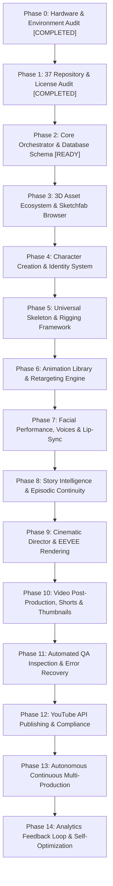

# Autonomous AI Cartoon Studio
## Comprehensive Implementation Roadmap (Phases 0 through 14 V2.0)

---

### Roadmap Summary

---

### Detailed Phase Specifications

#### Phase 0: Hardware & Environment Audit
- **Status:** **COMPLETED & VERIFIED.**
- **Deliverables:** Audited Intel i5-8265U (4C/8T), 16GB RAM, Intel UHD 620 iGPU, 250GB Free disk on E:. Headless Blender 4.2 LTS verified. Pure CPU-first and iGPU execution parameters established.

#### Phase 1: 37 Repository & License Audit
- **Status:** **COMPLETED & VERIFIED.**
- **Deliverables:** Complete classification of all 37 repositories into CORE (15), OPTIONAL (13), REFERENCE (4), EXPERIMENTAL (2), and RESTRICTED (3). Strict commercial verification for YouTube monetization.

#### Phase 2: Core Application, Database & Orchestration Engine
- **Objectives:** Deploy `data/studio_v2.db` with SQLite WAL mode; initialize the durable state machine (`QUEUED` → `PLANNING` → `GENERATING` → `ANIMATING` → `RENDERING` → `QUALITY_CHECK` → `READY_TO_PUBLISH` → `PUBLISHED`).
- **Acceptance Criteria:** Job state transitions survive sudden task restarts; task runner correctly isolates processes with RAM/CPU safety thresholds.

#### Phase 3: Asset Marketplace & Ingestion Pipeline
- **Objectives:** Implement `modules/asset_marketplace/` and `modules/asset_importer/`; build the Sketchfab-style 3D WebGL asset browser in the FastAPI web UI.
- **Acceptance Criteria:** Ingest GLB, glTF, FBX, OBJ assets with automated polygon count, material, and license metadata extraction; interactive 3D rotation in browser.

#### Phase 4: Character Creation & Identity Management
- **Objectives:** Connect `modules/character_engine/` and `character_identity/`; procedural base mesh generation via MPFB2; persistent character DNA profiles (Leo, Lumi, Aria).
- **Acceptance Criteria:** Procedural generation of child and adult characters with consistent proportions, hairstyles, and wardrobe across multiple blend scenes.

#### Phase 5: Universal Skeleton & Rig Adapters
- **Objectives:** Build `modules/universal_skeleton/`, `bone_mapping_engine/`, `rig_adapter_engine/`, and `skin_weight_validator/`.
- **Acceptance Criteria:** Automatic conversion and binding between Rigify, Mixamo 52-Bone, Unity Humanoid, and Unreal Mannequin skeletons; automated 4-bone weight normalization test.

#### Phase 6: Animation Library & Retargeting Engine
- **Objectives:** Build `modules/animation_library/`, `retargeting_engine/`, and `motion_capture_engine/` (MediaPipe landmark ingestion).
- **Acceptance Criteria:** Automated retargeting of 250+ walk, run, jump, and pointing clips onto custom characters with foot-sliding raycast ground locking.

#### Phase 7: Facial Performance, Voice & Lip-Sync
- **Objectives:** Connect `facial_animation_engine/`, `lipsync_engine/` (Rhubarb 9-viseme), and `voice_engine/` (Piper & Kokoro ONNX).
- **Acceptance Criteria:** Audio files automatically drive character jaw and mouth blendshapes with sub-frame alignment; organic eye blinking and wonder brow expressions.

#### Phase 8: Story Intelligence & Episode Continuity
- **Objectives:** Implement `story_engine/`, `story_memory/` (Lore DAG), and `episode_engine/`.
- **Acceptance Criteria:** Autonomous script generation with episodic memory ensuring past plot points, character growth, and unresolved cliffhangers carry forward into subsequent episodes.

#### Phase 9: Cinematic Scene Director & Local EEVEE Rendering
- **Objectives:** Implement `scene_director/`, `cinematic_camera_engine/`, and `render_engine/`.
- **Acceptance Criteria:** Autonomous camera selection (establishing shots, medium tracking, close-ups), depth of field, three-point lighting, and local EEVEE-Next rendering at 0.6s/frame.

#### Phase 10: Video Post-Production, Shorts & Thumbnails
- **Objectives:** Connect `editing_engine/`, `shorts_engine/`, and `thumbnail_engine/`.
- **Acceptance Criteria:** Automatic audio sidechain ducking (music lowers when character speaks), burned-in styled subtitles, vertical 9:16 Shorts formatting, and high-CTR hero thumbnails.

#### Phase 11: Automated Quality Inspection & Error Recovery
- **Objectives:** Implement `quality_control/` with 9 automated QA gates:
  1. Geometry deformation check (no polygon spikes or volume collapse).
  2. Audio clipping check (< 0 dBFS, no digital distortion).
  3. Black frame detection (no dropped render frames).
  4. Lip-sync alignment verification (visemes match voice audio duration).
  5. Eye contact & camera framing validation.
  6. Subtitle synchronization audit.
  7. Video duration check (exact Shorts 10s/30s/60s boundary).
  8. COPPA & family-safe compliance scanner.
  9. Recoverable error auto-retry engine.
- **Acceptance Criteria:** Flawed frames trigger automated camera or pose adjustment and re-render without human intervention.

#### Phase 12: YouTube Integration & Secure Publishing Gate
- **Objectives:** Connect `youtube_engine/` using official Google API OAuth2 tokens; resumable upload protocol; metadata optimization (SEO titles, descriptions, chapters, tags).
- **Acceptance Criteria:** Automated upload to YouTube with privacy status set to `private` or `scheduled` until human 1-click authorization is granted.

#### Phase 13: Fully Autonomous Multi-Production Operation
- **Objectives:** Autonomous scheduler executing multiple productions per week without human maintenance.
- **Acceptance Criteria:** Production of 5 Shorts and 1 Long-form episode in a 7-day unattended test run.

#### Phase 14: Analytics Feedback Loop & Continuous Improvement
- **Objectives:** Connect `analytics_engine/` using `yt-dlp` and YouTube Data API v3 to retrieve audience retention curves, CTR, and watch time.
- **Acceptance Criteria:** Historical retention dips automatically feed into future script pacing algorithms (shortening pauses, increasing early visual hooks).
