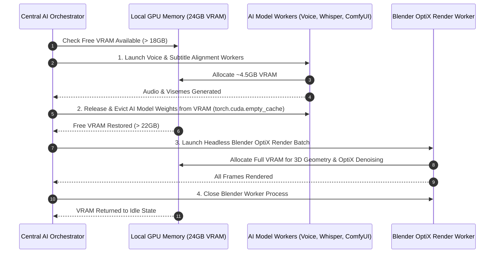

# Autonomous AI Cartoon Studio
## Local Dedicated GPU Hardware Configuration & Acceleration Specification

**Target Architecture:** High-Configuration Local Workstation  
**Recommended Compute Tier:** NVIDIA GeForce RTX 4090 / 4080 / 3090 / RTX 6000 Ada (16GB–24GB+ Dedicated VRAM)  
**Execution Mode:** 100% Local GPU Processing (Zero Cloud Dependencies)  

---

## 1. Local GPU Acceleration Stack

When deployed on a high-configuration production workstation, the studio activates the full **CUDA Acceleration & GPU Pipeline**:

```
+-----------------------------------------------------------------------------------+
|                        LOCAL HIGH-END GPU WORKSTATION                             |
|               (e.g., NVIDIA GeForce RTX 4090 / 24GB GDDR6X VRAM)                  |
+-----------------------------------------+-----------------------------------------+
                                          |
        +---------------------------------+---------------------------------+
        |                                                                   |
        v                                                                   v
+-------------------------------+                   +-------------------------------+
|     BLENDER 3D GPU PIPELINE   |                   |    AI INFERENCE GPU PIPELINE  |
+-------------------------------+                   +-------------------------------+
| • OptiX / CUDA Raytracing     |                   | • PyTorch 2.x (CUDA 12.x)     |
| • Hardware-Accelerated Denoiser|                  | • ONNX Runtime GPU Execution  |
| • Eevee-Next GPU Volumetrics  |                   | • ComfyUI Local Nodes (SDXL)  |
| • Real-time Viewport (30+ fps)|                   | • WhisperX Batched Alignment  |
| • 1-4s per frame render speed |                   | • Kokoro / Piper GPU TTS      |
+-------------------------------+                   +-------------------------------+
```

---

## 2. Component GPU Acceleration Configuration

### 2.1 Blender 4.2+ OptiX & Cycles GPU Acceleration
- **Render Engine:** `CYCLES` or `BLENDER_EEVEE_NEXT`.
- **Compute Device:** `OPTIX` (recommended for NVIDIA RTX hardware for hardware raytracing cores) or `CUDA`.
- **Denoising:** `OPTIX_DENOISER` (real-time AI denoising of render passes).
- **GPU Render Time Benchmark (RTX 4090):**
  - Stylized 1080x1920 Cartoon Short: **~0.8 to 2.5 seconds per frame**.
  - Total 30-Second Short Render: **~12 to 35 minutes**.
  - 5-Minute Long-Form Episode Render: **~2.0 to 4.5 hours**.

### 2.2 Neural Voice Inference (Kokoro & Piper on GPU)
- **Runtime:** `onnxruntime-gpu` configured with `CUDAExecutionProvider`.
- **Inference Speed:** **> 50x faster than real-time**. A full 5-minute episode dialogue script is synthesized in under 6 seconds.
- **VRAM Footprint:** ~1.2 GB VRAM.

### 2.3 Speech Alignment & Subtitles (WhisperX)
- **Model:** `whisper-large-v3` running on GPU with `fp16` precision and VAD preprocessing.
- **Execution Time:** ~4 seconds per minute of dialogue.
- **VRAM Footprint:** ~3.0 GB VRAM.

### 2.4 Generative Visual Layer (ComfyUI / Supporting Shots)
- **Execution:** Isolated ComfyUI background worker activated only during concepting, texture generation, or supplementary shot synthesis.
- **Precision:** `bf16` / `fp16` with `sdpa` attention optimization.
- **VRAM Footprint:** ~8.0 GB to 14.0 GB VRAM.

---

## 3. Dynamic VRAM Governance & Conflict Prevention

Running both Blender GPU rendering and deep-learning models simultaneously on a single GPU can trigger CUDA Out-of-Memory (OOM) errors. The **Central AI Orchestrator** enforces strict sequential VRAM management:



---

## 4. Hardware Profiles

The studio automatically selects the execution profile based on system discovery:

| Profile | Target Hardware | Render Engine | TTS Engine | Max Concurrency |
| :--- | :--- | :--- | :--- | :--- |
| **Cinematic Ultra (Default for High-End Rig)** | NVIDIA RTX 4090 / 3090 (24GB) | Cycles OptiX GPU (Samples: 128) | Kokoro GPU / Piper | 2 Background Tasks |
| **High Performance** | NVIDIA RTX 4070 / 3080 (12–16GB)| Eevee-Next GPU / Cycles (Samples: 64) | Kokoro / Piper | 1 Render Worker |
| **Low-Resource / Mobile Fallback** | Intel i5 / Integrated GPU (Shared)| Stylized NPR Eevee CPU (Samples: 32) | Piper CPU ONNX / Edge-TTS | 1 Worker, CPU capped |
