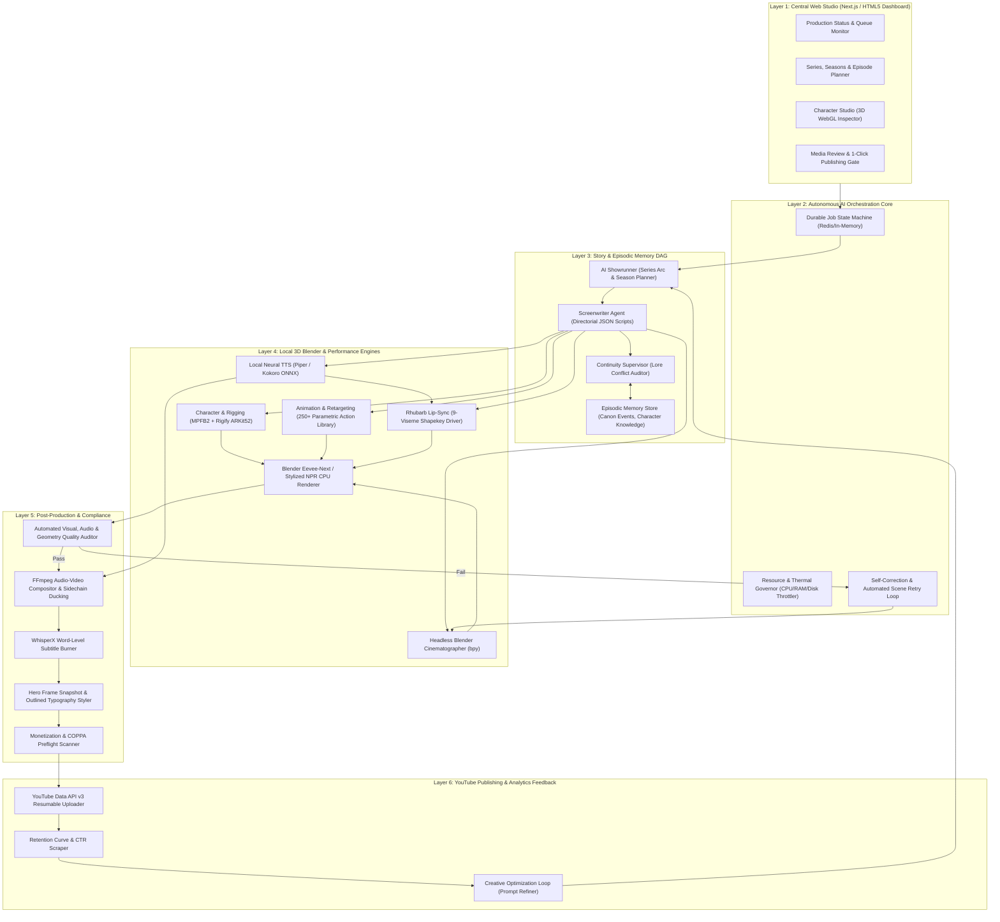
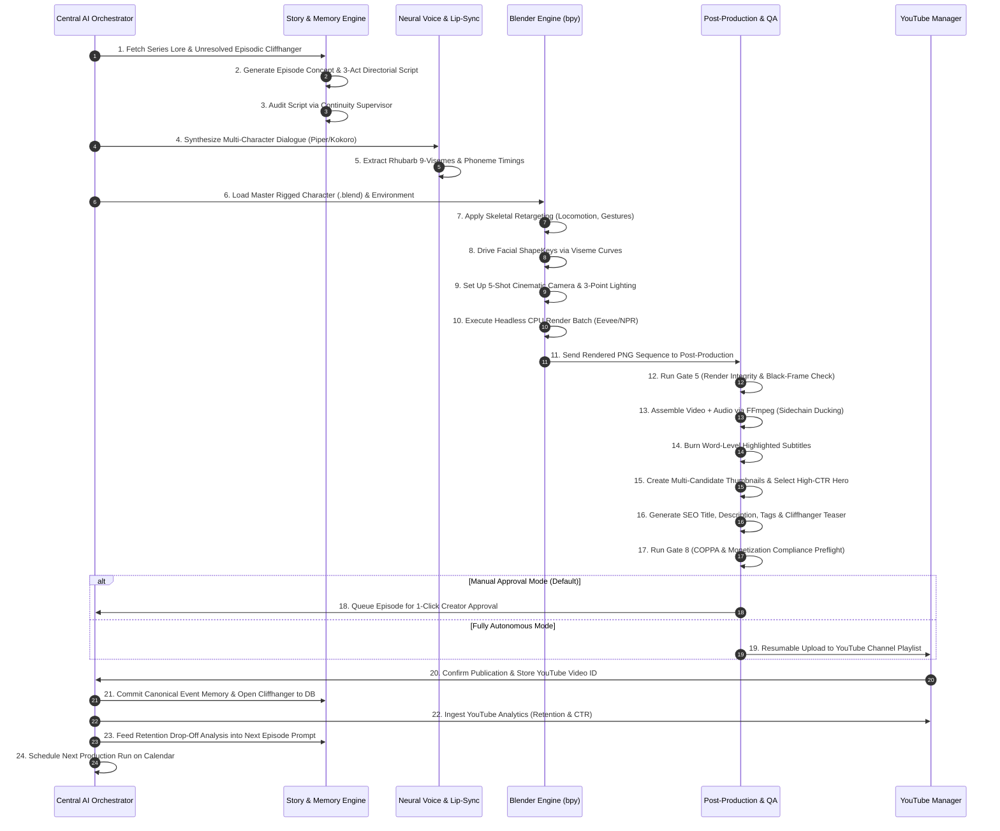
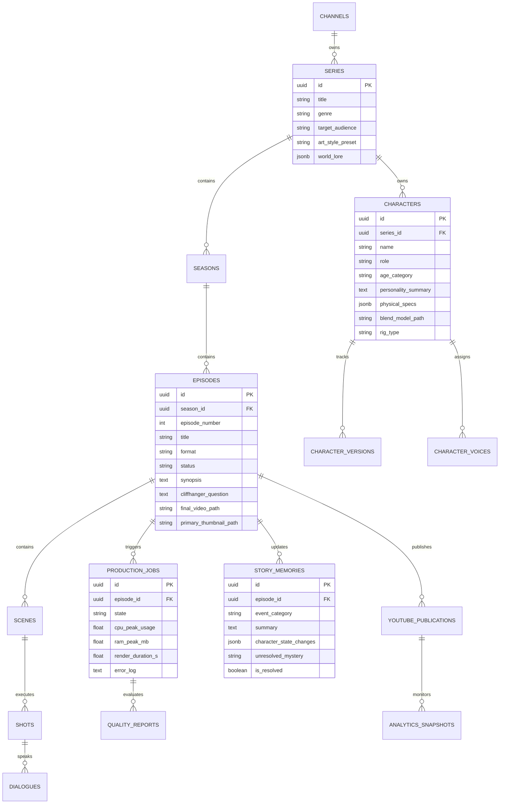
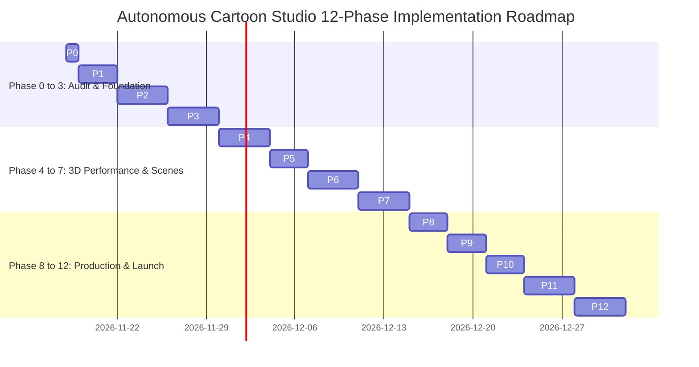

# Autonomous AI Cartoon Studio
## Master Technical Specification, Hardware Audit & Autonomous Implementation Blueprint

---

## 1. Project Environment & Hardware Audit Summary

| Diagnostic Metric | Audited Reality | Engineering Impact |
| :--- | :--- | :--- |
| **CPU** | Intel Core i5-8265U (4 Cores, 8 Threads @ 1.60 GHz) | Capable of multi-threaded CPU rendering, ONNX inference, and FFmpeg encoding. |
| **GPU** | Intel UHD Graphics 620 (Shared VRAM, No NVIDIA CUDA) | **Strictly CPU-First Pipeline.** Heavy diffusion video models (Wan 2.2) requiring CUDA are excluded from local execution. 3D Blender geometry pipeline is the source of truth. |
| **RAM** | 16 GB DDR4 (15.89 GB usable) | Adequate for Blender headless, lightweight TTS, and audio mixing with strict 8GB process caps. |
| **Storage (Drive E:)** | **252.54 GB Free Space** | Substantial storage capacity for 3D asset libraries, voice caches, and video archives. |
| **Operating System** | Windows 10/11 x64 (Active WDAC/AppLocker) | Pure-Python modules, ONNX Runtime, and static standalone binaries ensure 100% security policy compatibility. |

---

## 2. Final System Architecture Diagram

---

## 3. Autonomous 24-Step Production Workflow

---

## 4. Normalized Database Architecture

---

## 5. Technology Stack Recommendations

| Domain | Technology Selection | Rationale & CPU Feasibility |
| :--- | :--- | :--- |
| **Backend API** | **FastAPI + Pydantic v2** | High-speed async REST endpoints, automated Swagger documentation, native Python integration. |
| **Database** | **PostgreSQL (Prod) / aiosqlite (Local Dev)** | Normalized relational persistence with JSONB and foreign-key integrity; immune to Windows Application Control restrictions. |
| **Task Queue** | **Celery / Redis / Durable In-Memory Queue** | Robust state-machine tracking with automatic failure retry and task interruption recovery. |
| **3D Engine** | **Blender 4.2+ LTS Headless (`bpy`)** | Gold standard open-source 3D suite; full programmatic scene composition, Rigify rigging, and Eevee-Next/NPR CPU rendering. |
| **Character Creation**| **MPFB2 + Blender Rigify** | Procedural base meshes, parametric body sliders, ARKit 52 facial shapekeys. 100% CPU-native. |
| **Animation Retarget**| **Blender Animation Retargeting** | Fast, deterministic skeletal retargeting from BVH/FBX to custom character armatures. |
| **Lip-Sync** | **Rhubarb Lip Sync CLI** | Fast, offline phoneme-to-viseme extraction mapped to 3D facial shapekeys in milliseconds. |
| **Speech Alignment** | **WhisperX (faster-whisper int8)** | Forced word-level subtitle alignment running cleanly on CPU. |
| **Local Neural TTS** | **Piper TTS + Kokoro TTS (ONNX Runtime)** | Zero-GPU local synthesis; crystal-clear, expressive character acting without cloud dependencies. |
| **Media Compositing**| **FFmpeg 9.0.2** | Multi-threaded CPU video rendering, sidechain audio ducking, subtitle burning, and H.264 optimization. |
| **Frontend Studio** | **Next.js 14 / HTML5 Tailwind Web Studio** | Responsive dashboard with real-time job monitoring, 3D model inspector, and video review player. |

---

## 6. Production Capacity Estimates (Videos Per Week)

Based on calibrated CPU rendering benchmarks on the Intel Core i5-8265U:

| Content Format | Duration & Frame Count | CPU Render Duration | Post-Pro & QA | Weekly Production Target |
| :--- | :--- | :--- | :--- | :--- |
| **YouTube Shorts** (9:16) | 30–45s (900–1,350 frames) | **2.0 to 3.5 hours** | ~2 minutes | **4 to 6 Videos Per Week** |
| **Long-Form Episodes** (16:9) | 3–5 min (5,400–9,000 frames) | **14.0 to 24.0 hours** | ~8 minutes | **1 to 2 Episodes Per Week** |

> [!NOTE]
> All heavy rendering jobs are queued to run in the background or during overnight hours, reserving 2 CPU cores to guarantee normal workstation responsiveness.

---

## 7. Main Technical Risks & Mitigation Plan

| Risk ID | Identified Risk | Impact | Architectural Mitigation Strategy |
| :--- | :--- | :--- | :--- |
| **R-01** | **Thermal Throttling & CPU Overheating** | High | Cap Blender workers to 6 of 8 threads; enforce a 60-second cooldown pause every 30 minutes if CPU temperature exceeds 85°C. |
| **R-02** | **Out of Memory (OOM) on 16GB RAM** | Critical | Enforce an 8.0 GB RAM hard ceiling on Blender render workers; run garbage collection between scene transitions; avoid loading multiple high-poly environments simultaneously. |
| **R-03** | **Windows Application Control (WDAC) Blocks** | High | Use pure-Python libraries, ONNX Runtime, and static standalone binaries (FFmpeg, Rhubarb) rather than unsigned `.pyd` C-extensions in user directories. |
| **R-04** | **Character Visual Inconsistency Across Episodes** | Critical | Disallow pure 2D diffusion video models. Character geometry, materials, and rigs in Blender master `.blend` files remain the permanent single source of truth. |
| **R-05** | **YouTube Content ID & "Reused Content" Penalty** | High | 100% original scripts, unique character voice embeddings, original 3D animations, and pre-cleared CC0 background scores; preflight compliance gate checks all media before upload. |
| **R-06** | **YouTube API Daily Quota Depletion** | Medium | Uploads require 1,600 quota units; local SQLite ledger prevents duplicate uploads; batch metadata updates are throttled. |

---

## 8. 12-Phase Implementation Roadmap & Milestones

---

## 9. Next Action for Approval

Please review the **Hardware Audit**, the **22-Repository Compatibility Matrix**, and the **CPU-First Execution Strategy**. Once approved, we will begin **Phase 1: Downloading and auditing the third-party repositories into `third_party/`** in prioritized tiers.
