# Autonomous AI Cartoon Studio
## Master Architecture V2.0 — Cinematic 3D, Universal Rigging & Complete Asset Ecosystem

---

### Executive Architectural Declaration

The **Autonomous AI Cartoon Studio V2.0** is an integrated, local-first 3D cartoon creation and YouTube production platform. It unites the cinematic rendering power of **Blender (EEVEE-Next)**, the animation interoperability of **Autodesk Maya, Unity, and Unreal Engine**, and an internal **Sketchfab-style 3D asset ecosystem**.

> [!IMPORTANT]
> **Strict 3D Architecture:** All cartoon animation is driven by genuine 3D character meshes, universal skeletal bone deformation, facial blendshapes, and procedural PBR shading inside the Blender runtime (`bpy`). Flat 2D vector shapes and fake drawn overlays are permanently excluded.

---

### 1. Audited Hardware & Operating Parameters

| Component | Reality Detected | Production Constraint |
|---|---|---|
| **CPU** | Intel Core i5-8265U (4 Cores, 8 Threads @ 1.60 GHz) | Multi-threaded CPU rendering, ONNX inference, and FFmpeg encoding. |
| **GPU** | Intel UHD Graphics 620 (1GB Shared VRAM, OpenGL 4.6 / DX12) | **CPU-First & iGPU Optimized Pipeline.** Heavy CUDA diffusion video models excluded; Blender EEVEE-Next is production source of truth. |
| **RAM** | 16 GB DDR4 (15.89 GB Usable) | Hard process cap at 8 GB RAM per job to prevent system instability. |
| **Storage** | **250.53 GB Free on Drive E: (>688 GB Total Across System)** | Ample capacity for complete 3D asset libraries, voice caches, and video archives. |
| **OS** | Windows 10/11 x64 (PowerShell 5.1 / Python 3.12) | Clean pure-Python runtime, ONNX Runtime, and static binary integration. |

---

### 2. End-to-End System Architecture Diagram

```mermaid
flowchart TD
    subgraph Layer1 ["Layer 1: Central Web Studio & Sketchfab Asset Browser"]
        Dashboard["Web Studio Dashboard (FastAPI / 127.0.0.1:8000)"]
        AssetBrowser["Sketchfab-Style 3D Asset Browser (Three.js WebGL)"]
        SeriesManager["Series, Seasons & Episodic Continuity Planner"]
        PublishGate["Publishing Gate (Private / Scheduled / Authorization)"]
    end

    subgraph Layer2 ["Layer 2: Autonomous AI Orchestration & State Machine"]
        StateEngine["Durable Job State Machine (SQLite WAL)"]
        ResourceGov["Resource & Thermal Governor (CPU/RAM Throttler)"]
        RecoveryEngine["Self-Correction & Automated Error Recovery Loop"]
    end

    subgraph Layer3 ["Layer 3: Story Intelligence & Episodic Continuity DAG"]
        Showrunner["AI Showrunner (Series Arc & Seasonal Narrative)"]
        Screenwriter["Screenwriter (Directorial JSON Script Generator)"]
        LoreDAG["Episodic Lore Memory DAG (Canon Events & Relationships)"]
    end

    subgraph Layer4 ["Layer 4: Universal 3D Asset Ecosystem & Interchange"]
        AssetRepo["8-Category Asset Storage (Characters, Animals, Props, Environments)"]
        Interchange["Interchange Engine (glTF, FBX, USD, BVH)"]
        MayaAdapter["Maya HumanIK & FBX Joint Adapter"]
        UnityAdapter["Unity Mecanim Humanoid Adapter"]
        UnrealAdapter["Unreal Engine 5 Mannequin Adapter"]
    end

    subgraph Layer5 ["Layer 5: Universal Rigging & Character Engine"]
        MPFB2["Procedural Character Engine (MPFB2 / MakeHuman)"]
        UnivSkeleton["Universal Skeleton Framework (UHD-54 Canonical Bones)"]
        Retargeter["Automated Retargeting Engine (250+ Actions)"]
        SkinValidator["Skin Weight & Geometry Deformation Validator"]
        IKLock["Foot Sliding Raycast & Ground Lock Solver"]
    end

    subgraph Layer6 ["Layer 6: Performance & Speech Engines"]
        PiperTTS["Local Neural TTS (Piper & Kokoro ONNX)"]
        Rhubarb["Rhubarb Lip-Sync (9-Viseme Shapekey Driver)"]
        FacialEngine["Facial Expression Engine (ARKit 52 Blendshapes)"]
        MocapIngest["MediaPipe Markerless Mocap Integration"]
    end

    subgraph Layer7 ["Layer 7: Blender Cinematic Scene Director & Render"]
        BlenderHub["Headless Blender 4.2 LTS Engine (bpy)"]
        CameraDirector["Autonomous Camera Director (Tracking, Dolly, Medium, Close-Up)"]
        LightingRig["Cinematic Three-Point Lighting & Volumetric Atmosphere"]
        EeveeRender["EEVEE-Next PBR Renderer (AgX Color Management)"]
    end

    subgraph Layer8 ["Layer 8: Post-Production, Quality Assurance & YouTube"]
        FFmpegEngine["FFmpeg Multiplexer & Sidechain Audio Ducking"]
        Subtitles["WhisperX Word-Level Animated Shorts Subtitles"]
        QAGates["9-Gate Automated Quality Assurance Inspector"]
        YouTubeUploader["YouTube Data API v3 Resumable Uploader"]
        AnalyticsLoop["yt-dlp Audience Retention Feedback Loop"]
    end

    Layer1 --> Layer2
    Layer2 --> Layer3
    Layer3 --> Layer4
    Layer4 --> Layer5
    Layer5 --> Layer6
    Layer6 --> Layer7
    Layer7 --> Layer8
    Layer8 --> Layer1
```

---

### 3. Summary of Core Repository Classifications (37 Total)

| Integration Tier | Repository Count | Core Repositories Included |
|---|---|---|
| **CORE (Tier 1)** | **15** | MPFB2, blender-animation-retargeting, blender-addons (Rigify/glTF), MediaPipe, Rhubarb Lip Sync, WhisperX, Piper TTS, Kokoro TTS, Blender MCP (djeada), FFmpeg, MoviePy, glTF-Blender-IO, Poly Haven API, TreeGen, google-api-python-client, yt-dlp. |
| **OPTIONAL (Tier 2)** | **13** | MB-Lab, AnimStudio, FreeMocap, FaceXLib, Coqui TTS, Bark, Natron, HyperFrames, OpenUSD, Sketchfab Client, BlenderGIS. |
| **REFERENCE** | **4** | awesome-3d-blender-characters, Blender MCP (bpy-dev), OpenTopography. |
| **EXPERIMENTAL** | **2** | Anim Studio (DvaitAI), DeepMimic. |
| **RESTRICTED / EXCLUDED** | **3** | Deep Motion Editing (Non-commercial license), vid2anim (SMPL non-commercial), ChatTTS (CC-BY-NC 4.0). |

---

### 4. Detailed Architectural Documentation Suite

All twelve required foundational blueprints have been produced and linked below:

1. **[Hardware Capability Report](file:///E:/YT/docs/LOCAL_GPU_FEASIBILITY_REPORT_V2.md):** Full empirical benchmarks, CPU/iGPU operating boundaries, and throughput forecasts.
2. **[37-Repository Analysis & Audit](file:///E:/YT/docs/REPOSITORY_ANALYSIS_V2_37.md):** Exhaustive technical, licensing, and commercial analysis of all candidate repositories.
3. **[Asset License Register](file:///E:/YT/docs/ASSET_LICENSE_REGISTER.md):** Strict commercial-use permissions verifying YouTube monetization compliance.
4. **[Repository Compatibility Matrix](file:///E:/YT/docs/REPOSITORY_COMPATIBILITY_MATRIX.md):** Blender 4.2 LTS, Python 3.12, and OS security compliance register.
5. **[Complete 3D Asset Ecosystem Architecture](file:///E:/YT/docs/ASSET_ECOSYSTEM_ARCHITECTURE.md):** Sketchfab-style 3D browser, metadata schema, and 8 asset categories.
6. **[Universal Skeleton & Rigging Specification](file:///E:/YT/docs/UNIVERSAL_SKELETON_SPECIFICATION.md):** Canonical UHD-54 bone mapping, rig adapters, retargeting solver, and skin weight validator.
7. **[Animation Interoperability Plan](file:///E:/YT/docs/ANIMATION_INTEROPERABILITY_PLAN.md):** Cross-software workflows for Blender, Maya, Unity, and Unreal Engine.
8. **[Relational Database Schema V2.0](file:///E:/YT/docs/DATABASE_SCHEMA_V2.md):** SQLite DDL definitions for assets, rigs, animations, series, episodes, jobs, and QA.
9. **[Local GPU Feasibility Report](file:///E:/YT/docs/LOCAL_GPU_FEASIBILITY_REPORT_V2.md):** Detailed local execution benchmarks and preview/standard/cinematic profiles.
10. **[Implementation Roadmap (Phases 0–14)](file:///E:/YT/docs/IMPLEMENTATION_ROADMAP_V2.md):** Step-by-step milestones with clear acceptance criteria.
11. **[Risk Register & Self-Correction Matrix](file:///E:/YT/docs/RISK_REGISTER_V2.md):** 8 primary risk mitigations and automated error recovery loops.
12. **[YouTube Publishing & OAuth2 Guide](file:///E:/YT/docs/YOUTUBE_INTEGRATION.md):** Automated upload workflows with strict human authorization gates.
