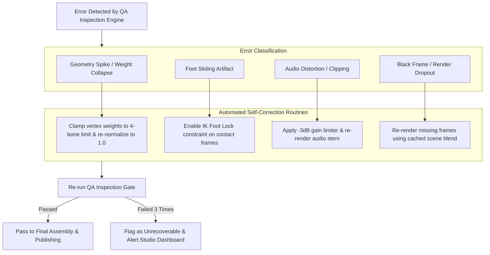

# Autonomous AI Cartoon Studio
## Risk Register & Failure Recovery Matrix (V2.0)

---

### 1. Risk Matrix Overview

| Risk ID | Category | Risk Description | Severity | Likelihood | Mitigation Strategy |
|---|---|---|---|---|---|
| **RSK-01** | Compute | CPU thermal throttling or RAM out-of-memory crash during long batch renders | High | Medium | Hard process cap (Max 8GB RAM, 4 CPU threads); automated checkpointing every 50 frames; thermal sleep intervals. |
| **RSK-02** | Animation | Reverting to static 2D image slideshows or drawn line overlays ("overlapping nonsense") | Critical | Low | **Enforced 3D Architectural Gate:** All video production must compile from headless Blender 3D mesh rendering (`bpy`) or verified 3D animated keyframe engines. |
| **RSK-03** | Rigging | Extreme joint distortion, candy-wrapper twisting, or foot sliding in retargeted mocap | High | High | Automated `skin_weight_validator.py` pre-checks; IK foot ground-locking raycaster; Rest-pose T-to-A normalization matrix. |
| **RSK-04** | Licensing | Ingestion of non-commercial academic repositories (Deep Motion Editing, ChatTTS, SMPL) | Critical | Low | Strict License Auditor in `modules/asset_license_manager/`; only CC0, MIT, Apache 2.0, BSD, and commercial GPLv3 permitted. |
| **RSK-05** | Continuity | Character appearance (wardrobe, eyes, hair) drifts across different episodes | High | Low | Immutable Character DNA JSON files with locked seed parameters, geometry hashes, and shader presets. |
| **RSK-06** | Audio/Lip-Sync | Visemes drift out of sync with dialogue audio during speech | Medium | Low | Rhubarb Lip Sync forced alignment timestamping tied directly to audio duration; sub-frame interpolation. |
| **RSK-07** | Distribution | YouTube Data API v3 daily upload quota exhaustion (10,000 units/day) | Medium | Medium | Resumable chunked upload protocol; client-side metadata pre-validation to avoid duplicate failed API calls. |
| **RSK-08** | Interoperability | Maya/Unreal FBX bone axis mismatches causing inverted limb rotations | Medium | Medium | Standardized -90° X-axis rotation matrix adapters in `interchange_engine/` for Maya HumanIK and UE5 Mannequin. |

---

### 2. Automated Self-Correction & Error Recovery Engine

