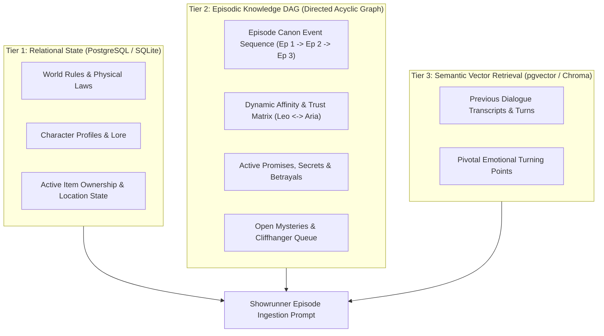

# Autonomous AI Cartoon Studio
## Story Intelligence & Long-Term Episodic Memory Architecture

---

## 1. The Story Memory Engine

To create cartoon series where viewers develop genuine emotional attachments, the platform operates a **Persistent Episodic Memory Engine**. 

Rather than generating isolated, disconnected episodes, the storytelling layer treats each series as a continuous narrative universe where:
- Secrets kept between characters persist.
- Physical injuries, acquired items, and discovered locations are remembered.
- Every cliffhanger introduced in Episode $N$ is actively resolved or advanced in Episode $N+1$.

---

## 2. Triple-Tier Memory DAG Architecture

The memory system is structured across three complementary tiers:

---

## 3. Cliffhanger Intelligence & Resolution Engine

Cliffhangers are one of the most critical drivers of YouTube subscriber retention and binge-watching behavior. 

The studio implements **Authentic Cliffhanger Intelligence**:
1. **Introduction**: A mystery, sudden arrival, or dilemma occurs in the final 15–20% of an episode.
2. **Commitment**: The cliffhanger question and teaser are logged in `story_memories` under `unresolved_mystery`.
3. **Resolution Requirement**: Before generating Episode $N+1$, the Showrunner Agent is injected with the exact unresolved question. The opening scene of Episode $N+1$ **MUST** resolve the immediate tension or advance the mystery with new information.
4. **Anti-Clickbait Rule**: Artificial, misleading cliffhangers (e.g. *a character screaming at an off-camera puppy that turns out to be harmless without story relevance*) are penalized and rejected by the Continuity Supervisor.

---

## 4. Continuity Supervisor Audit Rules

Before any generated screenplay is sent to the 3D Blender production queue, the **Continuity Supervisor Agent** evaluates the script against the following strict rules:
- **Rule C-1 (Character Presence)**: A character cannot appear in a scene if their current location state in `story_memories` places them elsewhere without travel time.
- **Rule C-2 (Item Integrity)**: A character cannot wield an artifact unless `item_states` records them as the current holder.
- **Rule C-3 (Knowledge Bounds)**: A character cannot reference events, secrets, or villain identities they have not yet witnessed or been told on-screen.
- **Rule C-4 (Relationship Consistency)**: Sudden radical shifts in character affinity (e.g., best friends becoming bitter enemies) require an explicit narrative catalyst event.
