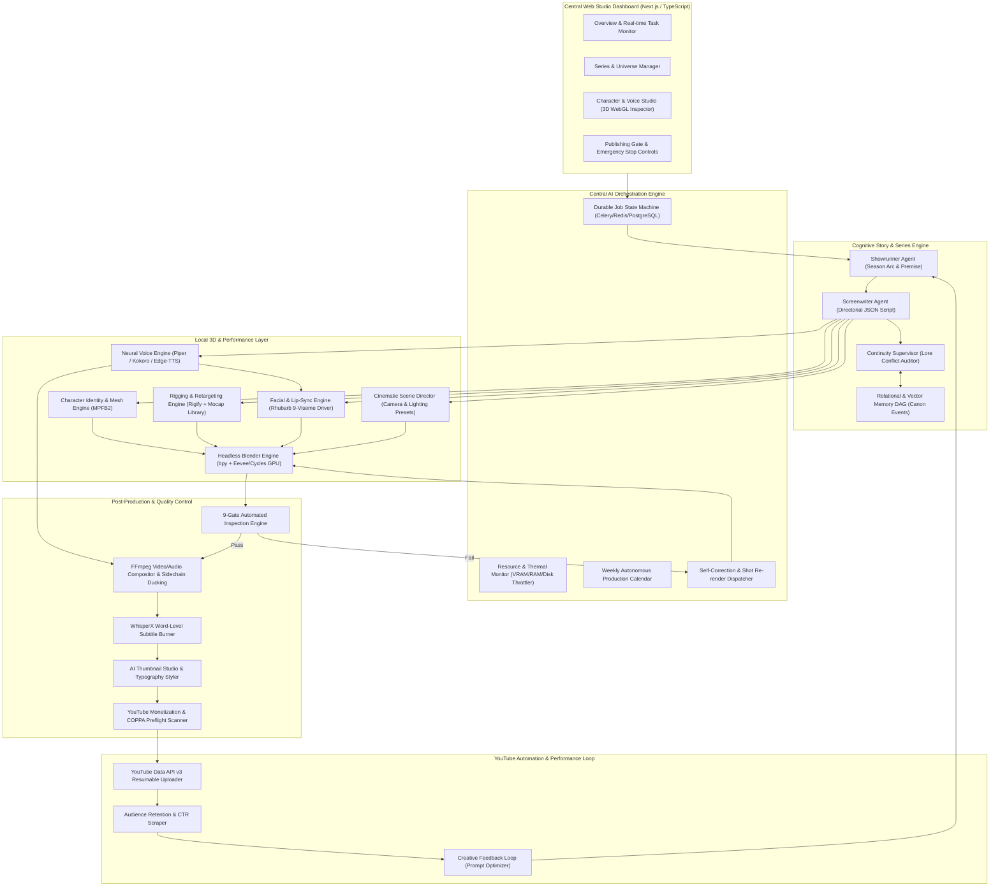

# Autonomous AI Cartoon Studio
## System Architecture Specification

**Project:** Autonomous AI Cartoon Studio  
**Architecture Type:** Event-Driven Modular Production Architecture  
**Target Execution:** Local GPU / Local-First Autonomous Operation  

---

## 1. Architectural Principles

1. **Deterministic Geometry & Rigging as Single Source of Truth**:
   - The studio separates character identity from frame generation. Character geometry (.blend), skeletal armatures (Rigify), and facial blendshapes (FACS 52) guarantee 100% visual permanence across all episodes and seasons.
2. **Modular Engine Isolation**:
   - Every production domain (Story, Voice, 3D Directing, Rendering, Compositing, YouTube, Quality Assurance) exists as an independent, decoupled module under `modules/` with defined input/output contracts.
3. **Durable State-Machine & Task Queue**:
   - No task is ephemeral. All production jobs follow a verifiable finite state machine:
     `QUEUED` → `PLANNING` → `SCRIPTING` → `VOICING` → `LIPSYNCING` → `ANIMATING` → `RENDERING` → `QUALITY_CHECK` → `ASSEMBLING` → `READY_TO_PUBLISH` → `PUBLISHED`.
4. **Self-Correction & Automatic Failure Recovery**:
   - If an error is detected during any gate (e.g. black frame, audio clipping, rig deformation), only the affected shot is queued for selective re-generation and re-rendering rather than restarting the entire episode.

---

## 2. Comprehensive System Architecture Diagram

---

## 3. Core Engine Responsibilities

### 3.1 Central AI Orchestrator (`backend/orchestrator/`)
- Manages the lifecycle of every production job.
- Monitors GPU memory usage, system RAM, CPU load, and disk thresholds.
- Enforces atomic state transitions and maintains immutable audit logs.
- Prevents duplicate episodes and concurrent GPU saturation.

### 3.2 Autonomous Character Creation Engine (`modules/character_engine/` & `modules/character_identity/`)
- Generates base quad meshes with correct edge loops for animation.
- Binds standard Rigify skeletons and 52 FACS / ARKit blendshapes.
- Assigns persistent Character IDs, material node trees, and voice profiles.
- Enforces character consistency across episodes.

### 3.3 Character Rigging & Animation Engine (`modules/rigging_engine/` & `modules/animation_engine/`)
- Houses the 250+ parametric action library (walk, run, jump, fight, emote, interact).
- Automatically retargets animations to custom character skeletons.
- Manages IK/FK switching, foot-ground contact alignment, and smooth action transitions.

### 3.4 Facial Expression & Lip-Sync Engine (`modules/lipsync_engine/` & `modules/facial_animation_engine/`)
- Ingests dialogue audio, extracts Rhubarb phonemes (A, B, C, D, E, F, G, H, X).
- Computes F-Curves for 3D mouth shapekeys (`jawOpen`, `mouthSmile`, `mouthPucker`, etc.).
- Injects procedural micro-expressions (eye blinking, saccades, brow furrows).

### 3.5 AI Voice & Dialogue Engine (`modules/voice_engine/`)
- Synthesizes emotional character speech using local ONNX neural models (Kokoro, Piper) or Edge-TTS.
- Applies pitch, speed, and volume modulation based on scene tension (whisper, excitement, terror, anger).
- Maintains unique, unchangeable voice embeddings for every recurring character.

### 3.6 AI Story & Series Intelligence Engine (`modules/story_engine/` & `modules/story_memory/`)
- Multi-agent cognitive loop: Showrunner outlines, Screenwriter drafts, Continuity Supervisor audits.
- Retrieves series lore and past episode events before drafting new scripts.
- Ends every episode with an authentic curiosity cliffhanger and addresses it in the subsequent episode.

### 3.7 Scene Director & Blender Production Engine (`modules/scene_director/` & `modules/render_engine/`)
- Programmatically scripts headless Blender sessions (`bpy`).
- Automatically frames cinematic camera compositions (establishing, medium, over-the-shoulder, close-up).
- Builds three-point lighting environments (Key, Fill, Rim, Ambient) and atmospheric volumetrics.
- Executes GPU rendering via Cycles or Eevee-Next with automated denoising.

### 3.8 Autonomous Editing & Post-Production (`modules/editing_engine/` & `modules/shorts_engine/`)
- FFmpeg-driven video and audio stem assembly.
- Implements dynamic sidechain compression (ducking music -14dB during character speech).
- Generates 16:9 long-form episodes and 9:16 vertical Shorts with highlighted subtitles.

### 3.9 Autonomous Thumbnail Engine (`modules/thumbnail_engine/`)
- Extracts expressive 3D hero keyframes.
- Applies dynamic high-contrast outlined typography.
- Scores candidates via an internal vision CTR ranker before selection.

### 3.10 Quality Control & Self-Correction Engine (`modules/quality_control/`)
- Validates the 9 production gates (geometry, rigging, lip-sync, audio clipping, black frames).
- Triggers targeted re-rendering of failing scenes without restarting the entire production.

### 3.11 Autonomous YouTube Manager & Compliance (`modules/youtube_engine/` & `modules/compliance_engine/`)
- Official YouTube Data API v3 OAuth2 resumable video uploader.
- Preflight scanner for COPPA ("Made for Kids") classification, advertiser suitability, and copyright clearance.
- Maintains a persistent upload ledger to prevent duplicate publishing.

### 3.12 Analytics & Continuous Learning Engine (`modules/analytics_engine/`)
- Ingests YouTube Analytics metrics (CTR, retention curves, average view duration).
- Identifies drop-off timestamps and feeds pacing adjustments into subsequent episode writing prompts.
