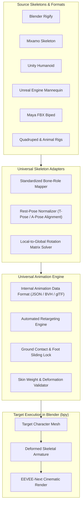
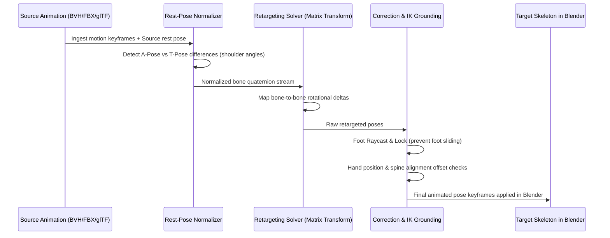

# Autonomous AI Cartoon Studio
## Universal Skeleton & Rigging Framework Specification (V2.0)

---

### 1. Architectural Vision & Objective

The **Universal Skeleton Compatibility Framework** establishes a standardized, cross-platform rigging and animation ecosystem. It allows characters modeled and rigged across different 3D applications (Blender, Maya, Unity, Unreal Engine, Mixamo, MakeHuman) to share, retarget, and execute animations interchangeably without manual re-rigging.

---

### 2. Standardized Bone-Role Hierarchy (Universal Humanoid Standard)

Every imported or procedural skeleton is mapped into a canonical **Universal Humanoid Definition (UHD-54)**:

| Canonical Bone Role | Rigify Equivalent | Mixamo Equivalent | Unity Humanoid | Unreal Engine 5 |
|---|---|---|---|---|
| **Root** | `root` | `mixamorig:Hips` | `Hips` | `pelvis` |
| **Pelvis / Hips** | `torso` / `hips` | `mixamorig:Hips` | `Hips` | `pelvis` |
| **Spine01 (Lower)** | `spine` | `mixamorig:Spine` | `Spine` | `spine_01` |
| **Spine02 (Mid)** | `spine.001` | `mixamorig:Spine1` | `Chest` | `spine_02` |
| **Spine03 (Chest)** | `spine.002` | `mixamorig:Spine2` | `UpperChest` | `spine_03` |
| **Neck** | `spine.004` | `mixamorig:Neck` | `Neck` | `neck_01` |
| **Head** | `spine.006` | `mixamorig:Head` | `Head` | `head` |
| **Eye Left / Right** | `eye.L` / `eye.R` | `eye.L` / `eye.R` | `LeftEye` / `RightEye`| `eye_l` / `eye_r` |
| **Clavicle L / R** | `shoulder.L / .R` | `mixamorig:LeftShoulder` | `LeftShoulder` | `clavicle_l / _r` |
| **Arm Upper L / R** | `upper_arm.L / .R` | `mixamorig:LeftArm` | `LeftUpperArm` | `upperarm_l / _r` |
| **Forearm L / R** | `forearm.L / .R` | `mixamorig:LeftForeArm`| `LeftLowerArm` | `lowerarm_l / _r` |
| **Hand L / R** | `hand.L / .R` | `mixamorig:LeftHand` | `LeftHand` | `hand_l / _r` |
| **Thumb (1, 2, 3)** | `thumb.01/.02/.03.L`| `mixamorig:LeftHandThumb1..3`| `Left Thumb Prox/Dist` | `thumb_01..03_l` |
| **Index (1, 2, 3)** | `f_index.01..03.L` | `mixamorig:LeftHandIndex1..3`| `Left Index Prox/Dist` | `index_01..03_l` |
| **Middle (1, 2, 3)**| `f_middle.01..03.L`| `mixamorig:LeftHandMiddle1..3`| `Left Middle Prox/Dist`| `middle_01..03_l` |
| **Ring (1, 2, 3)** | `f_ring.01..03.L` | `mixamorig:LeftHandRing1..3`| `Left Ring Prox/Dist` | `ring_01..03_l` |
| **Pinky (1, 2, 3)** | `f_pinky.01..03.L` | `mixamorig:LeftHandPinky1..3`| `Left Little Prox/Dist`| `pinky_01..03_l` |
| **UpLeg (Thigh) L/R**| `thigh.L / .R` | `mixamorig:LeftUpLeg` | `LeftUpperLeg` | `thigh_l / _r` |
| **Leg (Shin) L/R** | `shin.L / .R` | `mixamorig:LeftLeg` | `LeftLowerLeg` | `calf_l / _r` |
| **Foot L / R** | `foot.L / .R` | `mixamorig:LeftFoot` | `LeftFoot` | `foot_l / _r` |
| **ToeBase L / R** | `toe.L / .R` | `mixamorig:LeftToeBase` | `LeftToes` | `ball_l / _r` |

---

### 3. Non-Humanoid Rig Families & Quadruped Adapters

In addition to standard humanoids, the Universal Skeleton Framework defines specialized bone topology graphs for:

1. **Quadruped Family (Dogs, Cats, Horses):**
   - Spine: `Pelvis` → `Lumbar` → `Thoracic` → `Cervical` → `Skull`.
   - Forelimbs: `Scapula` → `Humerus` → `Radius/Ulna` → `Carpus` → `Metacarpus` → `Phalanges`.
   - Hindlimbs: `Pelvis` → `Femur` → `Tibia/Fibula` → `Hock/Tarsus` → `Metatarsus` → `Digits`.
   - Tail Chain: 4 to 12 flexible segments with automatic wave spring physics.

2. **Avian Family (Birds & Winged Creatures):**
   - Wing Chain: `Clavicle` → `Humerus` → `Radius` → `Carpometacarpus` → `Primary/Secondary Flight Feathers`.

3. **Facial Expression Rig (ARKit 52 Standard):**
   - 52 standard blendshape targets covering eyes (`eyeBlinkLeft/Right`, `eyeLookUp/Down/In/Out`), brows (`browDownLeft`, `browInnerUp`), jaw (`jawOpen`, `jawLeft/Right`), and mouth (`mouthSmile`, `mouthFrown`, `mouthPucker`, `mouthFunnel`).

---

### 4. Automated Retargeting Pipeline

#### Automated Correction Mechanisms:
- **Foot Sliding Lock:** Detects when target foot bone velocity drops below 0.05 m/s near ground plane (`Z ≈ 0`) and dynamically pins the foot coordinate, calculating inverse kinematics (IK) for knee and thigh.
- **Shoulder Rest-Pose Offset:** Corrects 45° A-pose to 90° T-pose offsets without deformation pinching.
- **Root Motion Scaling:** Scales root bone translation by `Height_Target / Height_Source` ratio to maintain proper travel distance across varying character sizes.

---

### 5. Skin-Weight & Topology Validation Engine

Before an asset enters production scenes, `skin_weight_validator.py` executes automated validation:

1. **Weight Normalization:** Sum of bone weights for every single vertex must equal exactly `1.000` (tolerance: `±0.001`).
2. **Influence Limitation:** Max 4 active bone influences per vertex for real-time glTF / WebGL / game engine compatibility.
3. **Extreme Joint Deformation Test:** Automatically flexes knees (120°), elbows (130°), and spine (45°) to test for volume collapse or self-intersecting polygons (candy-wrapper artifacts).
4. **Degenerate Geometry Check:** Rejects zero-area faces, non-manifold edges, and unassigned vertices.
